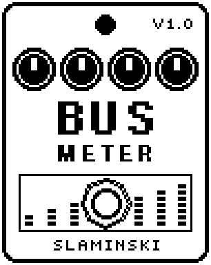

# BusMeter 1.00

A measuring tool that shows how loud the signal is at its place in the chain, and from which level the pedal starts to distort.

- **Version:** 1.00
- **Files:** `BUSMETER.ZD2` and `BUSMETER.ZIC` (install both)
- **Played by:** nothing to play: a measuring tool, not needed for playing
- **On the pedal:** PITCH SHIFT, like every effect of this collection (see [About the files](../README.md#about-the-files))
- **Id:** `07000f78`
- **DSP load:** 10, as declared to the pedal (a patch on the MS-60B+ has room for 270)
- **Delay memory:** none
- **Tested on:** one Zoom MS-60B+, firmware 1.20 only (the same effect code, installed in its own category; see [About the files](../README.md#about-the-files))

## What it does

BusMeter makes no sound of its own: your bass passes unchanged. Whenever the signal at this place in the chain gets as loud as Thr, the bass pulsates for half a second. With Tone On it adds a steady 110 Hz sine at the level TLvl sets, so you can hear from which level the pedal, or the effect behind BusMeter, starts to distort. It is a tool for testing, not a sound for a song.

## Playing it

- To measure your peak level: put BusMeter where you want to measure, play as hard as you ever do and turn Thr up until it no longer pulsates. The last value that pulsated is the peak at this place, in dB (0 dB is 1.0).
- To find where the sound starts to distort: turn the amp down, set Tone On, then turn TLvl up step by step until the sine no longer sounds clean. That is where the pedal, or the effect behind BusMeter, starts to distort.
- Move BusMeter to another place in the chain to measure there.

## Knobs

| Knob | Range | Default | What it does |
|---|---|---|---|
| `Thr` | -40 dB to +12 dB, in 2 dB steps | 0 dB | The level from which the bass pulsates. 0 dB is 1.0. |
| `Tone` | Off, On | Off | On adds a steady 110 Hz sine to whatever comes in. Turn the amp down first. |
| `TLvl` | -40 dB to +12 dB, in 2 dB steps | -40 dB | Peak level of the sine, on the same scale as Thr. |

## Good to know

- BusMeter is not needed for playing; do not save a patch with it. With Tone On in a saved patch, the sine would start as soon as you load the patch.
- The sine goes up to +12 dB, four times the level of 0 dB: turn the amp down before you set Tone On, and raise TLvl step by step.
- The sine itself is clean: any roughness you hear comes from the pedal or the effects behind BusMeter.

## Installing

Read the safety notes in the [collection's README](../README.md#read-this-first) and stomphacks' [SAFETY.md](https://github.com/thammer/stomphacks/blob/main/SAFETY.md) first. Install with [stomphacks](https://github.com/thammer/stomphacks), from its folder, one command at a time, checking each result:

1. `.venv/bin/python3 tools-pedal/safe_connect.py session/` connects and confirms that AUTO SAVE is off.
2. `.venv/bin/python3 tools-pedal/backup_pedal.py backup/` backs up the pedal (once per pedal).
3. `.venv/bin/python3 tools-pedal/pedal_diy.py install <this folder>/BUSMETER.ZD2 --dry-run`, then the same without `--dry-run`. It uploads `BUSMETER.ZIC` alongside: keep it next to the `.ZD2`, without it pedal_diy.py refuses.
4. `.venv/bin/python3 tools-pedal/readback.py BUSMETER.ZD2 session/BUSMETER-back.ZD2` and `cmp <this folder>/BUSMETER.ZD2 session/BUSMETER-back.ZD2`: they must be identical.
5. Try it in an unsaved patch, with the amp or headphones turned down.

To update to a newer version: take the effect out of every patch, `pedal_diy.py uninstall <this folder>/BUSMETER.ZD2` (the new file has the old one's name and id), then install the new one as in step 3 and read it back to a new path (for example `session/BUSMETER-back2.ZD2`; readback.py does not overwrite a file). The effect appears under PITCH SHIFT on the pedal (see the collection's README).
