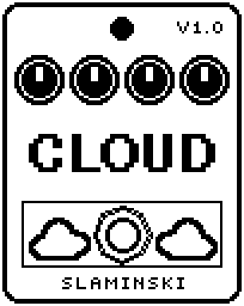

# Cloud 1.00

A granular cloud that replays your bass as overlapping grains, each at a pitch and a stereo place picked by chance, with the pitches kept in a scale if you like.

- **Version:** 1.00
- **Files:** `CLOUD.ZD2` and `CLOUD.ZIC` (install both)
- **Played by:** your bass
- **On the pedal:** PITCH SHIFT, like every effect of this collection (see [About the files](../README.md#about-the-files))
- **Id:** `07000f93`
- **DSP load:** 60, as declared to the pedal (a patch on the MS-60B+ has room for 270)
- **Delay memory:** 32 KB
- **Tested on:** one Zoom MS-60B+, firmware 1.20 only (the same effect code, installed in its own category; see [About the files](../README.md#about-the-files))

## What it does

Cloud works like Granular: up to four overlapping grains of 10 to 150 ms replay the last third of a second of your bass, each from its own place, forwards or backwards. On top of that, chance picks a pitch and a place between left and right for every new grain. The pitch lies up to Sprd semitones away from Pitch and takes only the notes that Quant allows, so the cloud can stay in a scale. Pan sets how far the grains spread to the sides.

## Playing it

- Start with the defaults: a dense cloud around the note you play, on the notes of the major scale up to 4 semitones away, spread between left and right.
- For octaves, set Quant to Oct and Sprd to 12. For fifths, set Quant to 5th and Sprd to 5 or more (5 adds the fourth below, 7 the fifth above).
- Sprd 0 puts all grains at Pitch, and Pan 0 keeps them all in the middle.
- Set Hold to On and the cloud keeps playing what the delay holds while you play over it. Mix 100 = the cloud only.

## Knobs

| Knob | Range | Default | What it does |
|---|---|---|---|
| `Size` | 0 to 100 | 45 | Length of a grain, 10 to 150 ms (60 = 51 ms). Short grains buzz at their own rate, long ones are small loops. |
| `Dens` | 0 to 100 | 90 | How many grains sound at once, 1 to 4 (67 = 3). At 1 they follow one another and the sound pulses; from 2 on they overlap. |
| `Pitch` | -12 to +12 semitones | 0 semitones | The pitch the cloud is centred on: the grains are read faster or slower. |
| `Sprd` | 0 to 12 semitones | 4 semitones | How far, by chance, a new grain's pitch may lie from Pitch, up or down. 0 = all grains at Pitch. |
| `Quant` | Off, Oct, 5th, Maj, Pent | Maj | Which pitches a random grain may take: Off = every semitone, Oct = octaves only, 5th = unison and fifths (and their octaves), Maj = the major scale from Pitch, Pent = the major pentatonic scale. |
| `Scat` | 0 to 100 | 60 | Scatter: how far back in time a grain may start, by chance. 0 = every grain plays what was just played; 100 = anything from the last third of a second. |
| `Rev` | 0 to 100 | 20 | Chance in percent that a grain plays backwards. |
| `Pan` | 0 to 100 | 60 | How far out to the left or right a new grain may sit, by chance. 0 = all in the middle. |
| `Fdbk` | 0 to 100 | 25 | How much of the grains goes back into the delay, up to 90 %. With Pitch away from 0 every round is shifted again. |
| `Hold` | Off, On | Off | On: nothing new is recorded; the grains keep playing what the delay holds. |
| `Mix` | 0 to 100 | 40 | Up to 50 the grains come in under the unchanged bass; above 50 the bass goes down. 100 = grains only. |
| `Level` | 0 to 100 | 80 | Output level while the effect is on. 80 = as loud as it comes in. |

## Good to know

- The random pitches never leave the range of the Pitch knob: at most an octave above or below the note you play.
- Cloud uses 32 KB of the pedal's delay memory. Without it, the bass passes and there are no grains. Every change to the chain (adding, removing or moving an effect) empties the delay.

## Installing

Read the safety notes in the [collection's README](../README.md#read-this-first) and stomphacks' [SAFETY.md](https://github.com/thammer/stomphacks/blob/main/SAFETY.md) first. Install with [stomphacks](https://github.com/thammer/stomphacks), from its folder, one command at a time, checking each result:

1. `.venv/bin/python3 tools-pedal/safe_connect.py session/` connects and confirms that AUTO SAVE is off.
2. `.venv/bin/python3 tools-pedal/backup_pedal.py backup/` backs up the pedal (once per pedal).
3. `.venv/bin/python3 tools-pedal/pedal_diy.py install <this folder>/CLOUD.ZD2 --dry-run`, then the same without `--dry-run`. It uploads `CLOUD.ZIC` alongside: keep it next to the `.ZD2`, without it pedal_diy.py refuses.
4. `.venv/bin/python3 tools-pedal/readback.py CLOUD.ZD2 session/CLOUD-back.ZD2` and `cmp <this folder>/CLOUD.ZD2 session/CLOUD-back.ZD2`: they must be identical.
5. Try it in an unsaved patch, with the amp or headphones turned down.

To update to a newer version: take the effect out of every patch, `pedal_diy.py uninstall <this folder>/CLOUD.ZD2` (the new file has the old one's name and id), then install the new one as in step 3 and read it back to a new path (for example `session/CLOUD-back2.ZD2`; readback.py does not overwrite a file). The effect appears under PITCH SHIFT on the pedal (see the collection's README).
