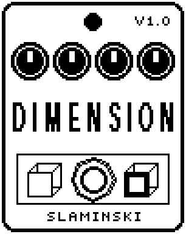

# Dimension 1.00

A stereo chorus for bass with five modes that adds a slowly moving copy to your bass and never thins out the low end.

- **Version:** 1.00
- **Files:** `DIMENSN.ZD2` and `DIMENSN.ZIC` (install both)
- **Played by:** your bass
- **On the pedal:** PITCH SHIFT, like every effect of this collection (see [About the files](../README.md#about-the-files))
- **Id:** `07000f8b`
- **DSP load:** 25, as declared to the pedal (a patch on the MS-60B+ has room for 270)
- **Delay memory:** 4 KB
- **Tested on:** one Zoom MS-60B+, firmware 1.20 only (the same effect code, installed in its own category; see [About the files](../README.md#about-the-files))

## What it does

Dimension adds a copy of your bass, delayed by about 6.5 ms on each side and moved slowly, the left side against the right. The bass itself is never turned down or shifted in phase; only the part above LoCut is chorused, so the low end stays whole. Tone dulls the copy like an analog bucket-brigade delay. Five modes set how far and how fast the copy moves: 1 to 4 get wider and faster, 1+4 lays mode 1 over mode 4.

## Playing it

- Start with the defaults: Mode 2, Mix 50, everything below 89.4 Hz left out of the chorus.
- Mode 1 is the slowest and narrowest, 4 the fastest and widest; 1+4 combines two movements. Depth scales the movement in every mode.
- Mix only adds the copy, up to 0.7 of the bass level at 100. The bass itself is never turned down.
- Lower Tone for a darker copy; raise LoCut to keep more of the low notes out of the chorus.

## Knobs

| Knob | Range | Default | What it does |
|---|---|---|---|
| `Mode` | 1, 2, 3, 4, 1+4 | 2 | How far and how fast the copy moves: 1 = 0.3 Hz, 0.3 ms either way; 2 = 0.45 Hz, 0.55 ms; 3 = 0.7 Hz, 0.9 ms; 4 = 1 Hz, 1.35 ms; 1+4 = mode 4 with mode 1 on top. |
| `Depth` | 0 to 100 | 50 | Scales the movement in every mode: 0 = 0.4 times, 50 = as listed under Mode, 100 = 1.6 times. |
| `Mix` | 0 to 100 | 50 | How much of the chorused copy is added: 0 = none (the bass unchanged), 100 = at 0.7 of the bass level. |
| `Tone` | 1.50k Hz to 14.0k Hz | 5.73k Hz | Low-pass on the copy, 12 dB per octave. Lower = darker, like an analog bucket-brigade delay. |
| `Width` | 0 to 100 | 100 | 0 = both sides move together, 100 = they move against each other. |
| `LoCut` | 20.0 Hz to 400 Hz | 89.4 Hz | High-pass on the copy, 24 dB per octave: below it the bass is not chorused, only passed. |
| `Level` | 0 to 100 | 80 | Output level. 80 = no change in level. |

## Good to know

- After you insert it, load a patch or change the chain, the chorus comes in after about 24 ms and fades in softly.
- Dimension uses 4 KB of the pedal's delay memory. Without it, the bass passes unchanged.

## Installing

Read the safety notes in the [collection's README](../README.md#read-this-first) and stomphacks' [SAFETY.md](https://github.com/thammer/stomphacks/blob/main/SAFETY.md) first. Install with [stomphacks](https://github.com/thammer/stomphacks), from its folder, one command at a time, checking each result:

1. `.venv/bin/python3 tools-pedal/safe_connect.py session/` connects and confirms that AUTO SAVE is off.
2. `.venv/bin/python3 tools-pedal/backup_pedal.py backup/` backs up the pedal (once per pedal).
3. `.venv/bin/python3 tools-pedal/pedal_diy.py install <this folder>/DIMENSN.ZD2 --dry-run`, then the same without `--dry-run`. It uploads `DIMENSN.ZIC` alongside: keep it next to the `.ZD2`, without it pedal_diy.py refuses.
4. `.venv/bin/python3 tools-pedal/readback.py DIMENSN.ZD2 session/DIMENSN-back.ZD2` and `cmp <this folder>/DIMENSN.ZD2 session/DIMENSN-back.ZD2`: they must be identical.
5. Try it in an unsaved patch, with the amp or headphones turned down.

To update to a newer version: take the effect out of every patch, `pedal_diy.py uninstall <this folder>/DIMENSN.ZD2` (the new file has the old one's name and id), then install the new one as in step 3 and read it back to a new path (for example `session/DIMENSN-back2.ZD2`; readback.py does not overwrite a file). The effect appears under PITCH SHIFT on the pedal (see the collection's README).
