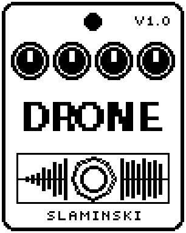

# Drone 1.00

A drone machine that fades in a held three-voice chord on the note you played last, on a note that follows your bass, or on a fixed note.

- **Version:** 1.00
- **Files:** `DRONE.ZD2` and `DRONE.ZIC` (install both)
- **Played by:** the footswitch
- **On the pedal:** PITCH SHIFT, like every effect of this collection (see [About the files](../README.md#about-the-files))
- **Id:** `07000f8d`
- **DSP load:** 69, as declared to the pedal (a patch on the MS-60B+ has room for 270)
- **Delay memory:** none
- **Tested on:** one Zoom MS-60B+, firmware 1.20 only (the same effect code, installed in its own category; see [About the files](../README.md#about-the-files))

## What it does

Drone plays a chord of three voices, each made of two slightly detuned oscillators, through a low-pass filter that breathes slowly up and down. LED on fades the drone in, LED off fades it out; Fade sets how long both take. At Level 80 the drone is about as loud as a normally played bass. The bass passes unchanged; the drone is added.

## Playing it

- After you insert it, load a patch or change the chain, Drone is silent, even with the LED on. Switch it off and on once. Save the patch with Drone switched off: then one press starts it.
- With Root at Bass, play a note and switch the drone on: it takes the note you played last and stays on it until it has faded out.
- With Root at Live, the drone follows your bass while it sounds, gliding to each new note in about 100 ms.
- With Root at a fixed note (C to B), you can change the note while the drone sounds, by hand or from the MS Plus Bridge.
- For a pad, use Saw with a low Cut. For a still sound, set Move to 0.

## Knobs

| Knob | Range | Default | What it does |
|---|---|---|---|
| `Root` | Bass, Live, C to B | Bass | The note of the drone: the note you played last (Bass, taken at the start), the bass as it moves (Live), or a fixed note. Always in the octave C1 to B1, moved by Oct. |
| `Oct` | -1, 0, +1, +2 | 0 | Octave of the root: 0 = C1 to B1 (33 to 62 Hz), -1 one octave lower, +1 and +2 higher. |
| `Chord` | Root, 5th, Oct, Sus4, Min, Maj, Min7, Maj7, Wide | 5th | The three voices. Root and Oct: the root with the octave below and above. 5th: root, fifth and octave below. Min7 is 0, 3, 10 semitones, Maj7 0, 4, 11, Wide 0, 7, 16. |
| `Voice` | Saw, Pulse, Organ, Sine | Saw | Saw: bright. Pulse: hollow. Organ: sine with the octave and the double octave. Sine: pure. |
| `Cut` | 55 Hz to 7.04k Hz | 793 Hz | Cutoff of the low-pass: the middle it breathes around. |
| `Move` | 0 to 100 | 35 | How far the cutoff breathes up and down, up to 30 semitones either way. 0 = still. |
| `Rate` | 0.030 Hz to 2.00 Hz | 0.130 Hz | How fast the cutoff breathes. The default is about 8 s a cycle. |
| `Sprd` | 0 to 100 | 30 | Detune of the two oscillators of every voice, 0 to 30 cents either way: the slow beating that makes a drone alive. |
| `Fade` | 0 to 100 | 40 | How long the drone takes to fade in and out, 30 ms to 8 s. |
| `Level` | 0 to 100 | 80 | Level of the drone: at 80 about as loud as a normally played bass. The bass is not affected. |

## Good to know

- Changing Voice while the drone sounds makes a small step in the sound.
- Inserting or moving an effect in the chain while it plays makes the drone silent again: switch it off and on once.

## Installing

Read the safety notes in the [collection's README](../README.md#read-this-first) and stomphacks' [SAFETY.md](https://github.com/thammer/stomphacks/blob/main/SAFETY.md) first. Install with [stomphacks](https://github.com/thammer/stomphacks), from its folder, one command at a time, checking each result:

1. `.venv/bin/python3 tools-pedal/safe_connect.py session/` connects and confirms that AUTO SAVE is off.
2. `.venv/bin/python3 tools-pedal/backup_pedal.py backup/` backs up the pedal (once per pedal).
3. `.venv/bin/python3 tools-pedal/pedal_diy.py install <this folder>/DRONE.ZD2 --dry-run`, then the same without `--dry-run`. It uploads `DRONE.ZIC` alongside: keep it next to the `.ZD2`, without it pedal_diy.py refuses.
4. `.venv/bin/python3 tools-pedal/readback.py DRONE.ZD2 session/DRONE-back.ZD2` and `cmp <this folder>/DRONE.ZD2 session/DRONE-back.ZD2`: they must be identical.
5. Try it in an unsaved patch, with the amp or headphones turned down.

To update to a newer version: take the effect out of every patch, `pedal_diy.py uninstall <this folder>/DRONE.ZD2` (the new file has the old one's name and id), then install the new one as in step 3 and read it back to a new path (for example `session/DRONE-back2.ZD2`; readback.py does not overwrite a file). The effect appears under PITCH SHIFT on the pedal (see the collection's README).
