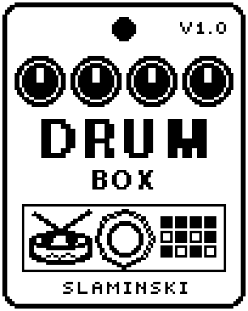

# DrumBox 1.00

A drum computer with kick, snare, hi-hat, cymbals and toms: 17 patterns with fills, in the tempo of the patch or at its own, added to your bass.

- **Version:** 1.00
- **Files:** `DRUMBOX.ZD2` and `DRUMBOX.ZIC` (install both)
- **Played by:** the footswitch
- **On the pedal:** PITCH SHIFT, like every effect of this collection (see [About the files](../README.md#about-the-files))
- **Id:** `07000f8a`
- **DSP load:** 38, as declared to the pedal (a patch on the MS-60B+ has room for 270)
- **Delay memory:** none
- **Tested on:** one Zoom MS-60B+, firmware 1.20 only (the same effect code, installed in its own category; see [About the files](../README.md#about-the-files))

## What it does

DrumBox plays a drum pattern next to your bass: kick, snare, hi-hat, ride and crash, with tom fills. The patterns are Rock, Rock2 (16th hats), HalfT (half time), Disco, House, Funk, Funk2, Shufl (shuffle), 1Drop (reggae), Metal (double kick), Boom (hip hop), Slow, Bossa, Punk, Waltz (3/4), Jazz (swing ride) and Click (a metronome). It runs in the tempo of the patch (BPM module or tap) or at its own 40 to 250 BPM. The bass passes unchanged; the drums are added.

## Playing it

- After you insert it or load a patch, DrumBox is silent, even with the LED on. Switch it off and on once. From then on LED on plays from bar 1 with a crash, and LED off stops it (what is still sounding rings out).
- Save the patch with DrumBox switched off: then one press of the footswitch starts it.
- Leave Tempo on Sync and set the tempo with the BPM module or by tap, or choose your own tempo with the Tempo knob.
- Mix the kit with Kick, Snare, HiHat and Cym (0 mutes a drum), and set the drums against the bass with Level. A new pattern starts with the next bar, so you can change it while it plays.

## Knobs

| Knob | Range | Default | What it does |
|---|---|---|---|
| `Pattern` | Rock to Click (17 patterns) | Rock | The beat (see the list above). A new pattern starts with the next bar. |
| `Tempo` | 40 to 250 BPM, Sync | Sync | Sync: the tempo of the patch (BPM module, tap). 40 to 250: its own tempo in BPM. |
| `Level` | 0 to 100 | 80 | Volume of the drums. The bass is not affected. |
| `Swing` | 0 to 100 | 0 | Moves every second eighth note later: 0 = straight, 67 = triplet shuffle, 100 = dotted. Not with Shufl and Jazz, which swing already. |
| `Kick` | 0 to 100 | 80 | Volume of the kick. 0 = off. |
| `Snare` | 0 to 100 | 70 | Volume of the snare and of the toms in the fills. 0 = off. |
| `HiHat` | 0 to 100 | 60 | Volume of the hi-hat and of the count-in. 0 = off. |
| `Cym` | 0 to 100 | 50 | Volume of the cymbals: the ride, and the crash on the first beat and after a fill. 0 = off. |
| `Tune` | 0 to 100 | 50 | Pitch of all drums: 0 and 100 are an octave below and above. |
| `Decay` | 0 to 100 | 50 | Length of all drums: 0 = half, 100 = twice as long. |
| `Fill` | Off, 4Bar, 8Bar, 16Bar | 8Bar | A fill in the second half of every 4th, 8th or 16th bar, then a crash. |
| `CountIn` | Off, 1Bar, 2Bar | Off | One or two bars of hi-hat clicks after the start, then the pattern. |

## Good to know

- With Tempo on Sync, a new patch tempo arrives only when the Tempo knob is moved: after you change the tempo, turn Tempo away from Sync and back.
- Inserting or moving an effect in the chain while DrumBox plays makes it silent again: switch it off and on once.
- The pedal shows Pattern and CountIn shortened to five letters until you select the knob.

## Installing

Read the safety notes in the [collection's README](../README.md#read-this-first) and stomphacks' [SAFETY.md](https://github.com/thammer/stomphacks/blob/main/SAFETY.md) first. Install with [stomphacks](https://github.com/thammer/stomphacks), from its folder, one command at a time, checking each result:

1. `.venv/bin/python3 tools-pedal/safe_connect.py session/` connects and confirms that AUTO SAVE is off.
2. `.venv/bin/python3 tools-pedal/backup_pedal.py backup/` backs up the pedal (once per pedal).
3. `.venv/bin/python3 tools-pedal/pedal_diy.py install <this folder>/DRUMBOX.ZD2 --dry-run`, then the same without `--dry-run`. It uploads `DRUMBOX.ZIC` alongside: keep it next to the `.ZD2`, without it pedal_diy.py refuses.
4. `.venv/bin/python3 tools-pedal/readback.py DRUMBOX.ZD2 session/DRUMBOX-back.ZD2` and `cmp <this folder>/DRUMBOX.ZD2 session/DRUMBOX-back.ZD2`: they must be identical.
5. Try it in an unsaved patch, with the amp or headphones turned down.

To update to a newer version: take the effect out of every patch, `pedal_diy.py uninstall <this folder>/DRUMBOX.ZD2` (the new file has the old one's name and id), then install the new one as in step 3 and read it back to a new path (for example `session/DRUMBOX-back2.ZD2`; readback.py does not overwrite a file). The effect appears under PITCH SHIFT on the pedal (see the collection's README).
