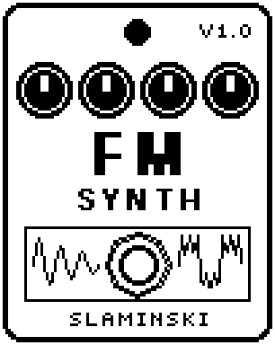

# FMSynth 1.00

An FM synth voice played by your bass, from a pure sine to hollow, bright, bell-like and gritty tones, with every note starting bright and settling.

- **Version:** 1.00
- **Files:** `FMSYNTH.ZD2` and `FMSYNTH.ZIC` (install both)
- **Played by:** your bass
- **On the pedal:** PITCH SHIFT, like every effect of this collection (see [About the files](../README.md#about-the-files))
- **Id:** `07000f85`
- **DSP load:** 55, as declared to the pedal (a patch on the MS-60B+ has room for 270)
- **Delay memory:** none
- **Tested on:** one Zoom MS-60B+, firmware 1.20 only (the same effect code, installed in its own category; see [About the files](../README.md#about-the-files))

## What it does

FMSynth turns every note you play into an FM voice: a sine at the pitch of your bass whose phase is bent by a second sine. Depth, Ratio and Fdbk set the colour. Each note starts bright and falls to the share of Depth set by Sus, at the speed of Decay. It plays one note at a time, not chords.

## Playing it

- The defaults give a round voice on your note, beside your clean bass. That voice is close to a sine on your own note, so it blends with the bass: set Oct to +1 or Ratio to 2 to hear it as a voice of its own.
- Ratio sets the character: 1 round and full, 2 hollow, 3 and up thin and bright, 0.5 a growl. The last four values (1.41, 2.72, 3.14, 5.19) give bells and clangs.
- A short Decay with a low Sus gives a bright attack that quickly turns pure. Sus 100 keeps the brightness for the whole note.
- Dyn 0 makes every note as loud and as bright as the next, held until the bass stops. At 100, level and brightness follow your playing.

## Knobs

| Knob | Range | Default | What it does |
|---|---|---|---|
| `Depth` | 0 to 100 | 55 | How far the second sine bends the voice: 0 = a pure sine, 100 = very bright. At high Depth, high notes get a little less, so that they stay clean. |
| `Ratio` | 0.5, 1, 1.5, 2, 3 to 10, 1.41, 2.72, 3.14, 5.19 | 1 | Pitch of the second sine against the voice. The last four are not whole numbers: bells and clangs. |
| `Decay` | 0 to 100 | 45 | How fast the brightness falls from Depth to Sus after a note starts, 10 ms to 4 s. |
| `Sus` | 0 to 100 | 25 | Share of Depth that stays while the note is held. 0 = the note ends as a pure sine, 100 = no fall at all. |
| `Fdbk` | 0 to 100 | 0 | The second sine bends itself: rougher, towards a saw and then noise. |
| `Fine` | 0 to 100 | 0 | The second sine a little sharp, up to 30 cents: the colour moves slowly. |
| `Oct` | -1, 0, +1 | 0 | The voice an octave below, on, or an octave above the note of the bass. |
| `Sub` | 0 to 100 | 0 | Level of a pure sine one octave below the bass. |
| `Dyn` | 0 to 100 | 70 | How much of your playing comes through: 0 = every note the same, 100 = level and brightness follow the bass. |
| `Dry` | 0 to 100 | 80 | Level of your bass. 80 = unchanged, as loud as bypassed; 0 = only the synth. |
| `Level` | 0 to 100 | 80 | Level of the synth, 80 = unity. The bass is not affected. |
| `Sens` | 0 to 100 | 50 | Input sensitivity. Raise it for a quiet bass, lower it if noise sets the synth off. |

## Good to know

- A plucked note sounds two to five cycles after the pluck: low notes after two to four, notes above about 130 Hz after four to five (about 20 ms).
- With a high Depth, Fdbk makes high notes fold back and turn gritty, most at the higher ratios. At Depth 55 it stays clean up to Fdbk 50.
- Above Dyn 0 the brightness comes up with the level: a plucked note is brightest a few ms in, and with a short Decay it stays below Depth.
- Runs on the pedal together with OrganSynth, a compressor, a delay and a reverb in one patch.

## Installing

Read the safety notes in the [collection's README](../README.md#read-this-first) and stomphacks' [SAFETY.md](https://github.com/thammer/stomphacks/blob/main/SAFETY.md) first. Install with [stomphacks](https://github.com/thammer/stomphacks), from its folder, one command at a time, checking each result:

1. `.venv/bin/python3 tools-pedal/safe_connect.py session/` connects and confirms that AUTO SAVE is off.
2. `.venv/bin/python3 tools-pedal/backup_pedal.py backup/` backs up the pedal (once per pedal).
3. `.venv/bin/python3 tools-pedal/pedal_diy.py install <this folder>/FMSYNTH.ZD2 --dry-run`, then the same without `--dry-run`. It uploads `FMSYNTH.ZIC` alongside: keep it next to the `.ZD2`, without it pedal_diy.py refuses.
4. `.venv/bin/python3 tools-pedal/readback.py FMSYNTH.ZD2 session/FMSYNTH-back.ZD2` and `cmp <this folder>/FMSYNTH.ZD2 session/FMSYNTH-back.ZD2`: they must be identical.
5. Try it in an unsaved patch, with the amp or headphones turned down.

To update to a newer version: take the effect out of every patch, `pedal_diy.py uninstall <this folder>/FMSYNTH.ZD2` (the new file has the old one's name and id), then install the new one as in step 3 and read it back to a new path (for example `session/FMSYNTH-back2.ZD2`; readback.py does not overwrite a file). The effect appears under PITCH SHIFT on the pedal (see the collection's README).
