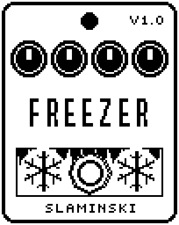

# Freezer 1.00

A freeze that holds the note you are playing when you press the footswitch, as a steady loop you can play over.

- **Version:** 1.00
- **Files:** `FREEZER.ZD2` and `FREEZER.ZIC` (install both)
- **Played by:** your bass
- **On the pedal:** PITCH SHIFT, like every effect of this collection (see [About the files](../README.md#about-the-files))
- **Id:** `07000f76`
- **DSP load:** 55, as declared to the pedal (a patch on the MS-60B+ has room for 270)
- **Delay memory:** 32 KB
- **Tested on:** one Zoom MS-60B+, firmware 1.20 only (the same effect code, installed in its own category; see [About the files](../README.md#about-the-files))

## What it does

Freezer holds the note that sounds when you press the footswitch, or when you turn Frz to On, as a loop cut to the length of its own period. A new freeze fades in at the pace of Atk while the old one fades out at the pace of Rel. You keep playing over the held sound: Dry sets the level of your bass, Level the level of the held sound. Tone darkens the held sound, and Mod adds vibrato, tremolo or a filter sweep to it.

## Playing it

- With the defaults (FtSw on Next), every press of the footswitch takes a new freeze of the note that sounds. To let go, press with the strings muted.
- On Next the effect is never bypassed, whatever the LED shows. Set FtSw to OnOff if switching on should take a freeze and switching off should bypass the effect.
- For slow swells between held notes, turn Atk and Rel up (up to 6 s each). Dry 0 leaves only the held sound.
- For movement in the held note, pick MType and turn Mod up: Vib for vibrato, Trem for tremolo, Filt for a slow filter sweep.

## Knobs

| Knob | Range | Default | What it does |
|---|---|---|---|
| `Frz` | Off, On | On | On: the effect holds a note and takes a new one each time the footswitch asks for one (see FtSw) or this knob goes from Off to On. Off: what is held fades away at the pace of Rel. |
| `Atk` | 0 to 100 | 30 | Attack: how long a freeze takes to fade in, 10 ms to 6 s (30 = 68 ms). |
| `Rel` | 0 to 100 | 50 | Release: how long a freeze takes to fade out, when Frz goes to Off or a new freeze comes in over it, 10 ms to 6 s (50 = 245 ms). |
| `Dry` | 0 to 100 | 80 | Level of your bass while the effect is on. 80 = as loud as bypassed, 0 = only the frozen sound, 100 = 1.5 times. |
| `Tone` | 200 Hz to 12.0k Hz, Open | Open | Cutoff of a low-pass on the frozen sound. Open, the last step, is no filter at all. |
| `Level` | 0 to 100 | 40 | Level of the frozen sound. 80 = as loud as the note was, 40 = half as loud. |
| `FtSw` | OnOff, Next | Next | Next: every press takes a new freeze, and the effect is never bypassed. OnOff: switching on takes a freeze, switching off bypasses the effect. |
| `MType` | Vib, Trem, Filt | Vib | What Mod does to the frozen sound: Vib = its pitch sways, Trem = its level pulses, Filt = the Tone low-pass sweeps down from where Tone is and back up (also with Tone on Open). |
| `Mod` | 0 to 100 | 0 | Depth of the modulation, 0 = off. At 100: Vib half a semitone each way, Trem down to nothing, Filt five octaves down from Tone. |
| `MRate` | 0.100 Hz to 8.00 Hz | 0.58 Hz | Speed of the modulation. |

## Good to know

- Watch the level: the held sound adds to what you play. With Dry and Level at 80, the two together can be twice as loud as your bass alone; at Level 40 (the default), one and a half times. Keep that in mind for the effects after it.
- Loading a patch with Freezer on does not freeze the note that is ringing: for 0.2 s after a patch load, a chain edit or inserting the effect, the footswitch does not count.
- After Vib, the held sound stays a little duller in the highs until the next freeze.
- Freezer uses 32 KB of the pedal's delay memory. Without it, the bass passes and nothing is held.

## Installing

Read the safety notes in the [collection's README](../README.md#read-this-first) and stomphacks' [SAFETY.md](https://github.com/thammer/stomphacks/blob/main/SAFETY.md) first. Install with [stomphacks](https://github.com/thammer/stomphacks), from its folder, one command at a time, checking each result:

1. `.venv/bin/python3 tools-pedal/safe_connect.py session/` connects and confirms that AUTO SAVE is off.
2. `.venv/bin/python3 tools-pedal/backup_pedal.py backup/` backs up the pedal (once per pedal).
3. `.venv/bin/python3 tools-pedal/pedal_diy.py install <this folder>/FREEZER.ZD2 --dry-run`, then the same without `--dry-run`. It uploads `FREEZER.ZIC` alongside: keep it next to the `.ZD2`, without it pedal_diy.py refuses.
4. `.venv/bin/python3 tools-pedal/readback.py FREEZER.ZD2 session/FREEZER-back.ZD2` and `cmp <this folder>/FREEZER.ZD2 session/FREEZER-back.ZD2`: they must be identical.
5. Try it in an unsaved patch, with the amp or headphones turned down.

To update to a newer version: take the effect out of every patch, `pedal_diy.py uninstall <this folder>/FREEZER.ZD2` (the new file has the old one's name and id), then install the new one as in step 3 and read it back to a new path (for example `session/FREEZER-back2.ZD2`; readback.py does not overwrite a file). The effect appears under PITCH SHIFT on the pedal (see the collection's README).
