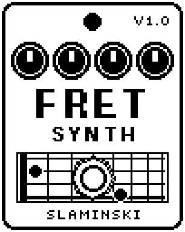

# FretSyn 1.00

A two-oscillator synth that plays the note of your bass, through a resonant four-pole low-pass filter that opens with every pluck.

- **Version:** 1.00
- **Files:** `FRETSYN.ZD2` and `FRETSYN.ZIC` (install both)
- **Played by:** your bass
- **On the pedal:** PITCH SHIFT, like every effect of this collection (see [About the files](../README.md#about-the-files))
- **Id:** `07000f7d`
- **DSP load:** 70, as declared to the pedal (a patch on the MS-60B+ has room for 270)
- **Delay memory:** none
- **Tested on:** one Zoom MS-60B+, firmware 1.20 only (the same effect code, installed in its own category; see [About the files](../README.md#about-the-files))

## What it does

FretSyn follows the pitch of your bass and plays it on two oscillators. Oscillator 2 can sit an interval away from oscillator 1 and be tuned a little sharp, and Oct moves both an octave down or up. The synth runs through a four-pole low-pass filter (24 dB per octave) with resonance: every pluck opens it by up to two octaves, and it closes again as the string dies away. It plays one note at a time, not chords.

## Playing it

- Start with the defaults: a saw and a square an octave below it, slightly detuned, beside your clean bass.
- For a thick unison sound, set Intvl to Unis and raise Detune. For a deeper synth line, set Oct to -1.
- Turn Cutoff down and Reso up for a squelchy filter that snaps open on every pluck. From Reso 91 on the filter sings by itself.
- For the synth alone, turn Dry to 0 and set its level with Level.
- If notes do not come through, lower Thr. If noise opens the synth in pauses, raise it.

## Knobs

| Knob | Range | Default | What it does |
|---|---|---|---|
| `Wave1` | Saw, Sqr, Tri, Sine | Saw | Wave shape of oscillator 1. |
| `Wave2` | Off, Saw, Sqr, Tri, Sine | Sqr | Wave shape of oscillator 2, or Off. |
| `Intvl` | -Oct, -4th, Unis, +5th, +Oct, +12th | -Oct | Where oscillator 2 plays against oscillator 1. |
| `Detune` | 0 to 100 | 20 | Oscillator 2 a little sharp, up to 30 cents: the two beat against each other. |
| `Oct` | -1, 0, +1 | 0 | Both oscillators an octave below, on, or an octave above the note of the bass. |
| `Cutoff` | 20.0 Hz to 10.0k Hz | 447 Hz | Cutoff of the filter at rest. Every pluck opens it by up to two octaves (a strong pluck: the full two), and it closes as the string dies away. |
| `Reso` | 0 to 100 | 30 | Resonance: a peak at the cutoff. From about 91 the filter sings by itself. The low end stays. |
| `Thr` | 0 to 100 | 45 | How loud the bass must be to open the gate of the synth. It closes again at half that level. |
| `Atk` | 0 to 100 | 15 | How fast the synth comes in once the gate is open and the pitch is known, 1 ms to 3 s. |
| `Rel` | 0 to 100 | 45 | How fast it fades once the gate has closed, 1 ms to 3 s. |
| `Dry` | 0 to 100 | 100 | Level of your bass beside the synth. 100 = unchanged, 0 = only the synth. |
| `Level` | 0 to 100 | 80 | Level of the synth. 80 = normal, 100 = about 3.5 dB louder. The bass is set with Dry. |

## Good to know

- The synth starts about one cycle of the note after the pluck: on a low E 25 to 50 ms.
- A new note is jumped to, without a glide. Bends, slides and vibrato are followed.
- Played on the pedal with drive, chorus, delay and reverb behind it: no crackle.
- The pedal shows Detune and Cutoff shortened to five letters until you select the knob.

## Installing

Read the safety notes in the [collection's README](../README.md#read-this-first) and stomphacks' [SAFETY.md](https://github.com/thammer/stomphacks/blob/main/SAFETY.md) first. Install with [stomphacks](https://github.com/thammer/stomphacks), from its folder, one command at a time, checking each result:

1. `.venv/bin/python3 tools-pedal/safe_connect.py session/` connects and confirms that AUTO SAVE is off.
2. `.venv/bin/python3 tools-pedal/backup_pedal.py backup/` backs up the pedal (once per pedal).
3. `.venv/bin/python3 tools-pedal/pedal_diy.py install <this folder>/FRETSYN.ZD2 --dry-run`, then the same without `--dry-run`. It uploads `FRETSYN.ZIC` alongside: keep it next to the `.ZD2`, without it pedal_diy.py refuses.
4. `.venv/bin/python3 tools-pedal/readback.py FRETSYN.ZD2 session/FRETSYN-back.ZD2` and `cmp <this folder>/FRETSYN.ZD2 session/FRETSYN-back.ZD2`: they must be identical.
5. Try it in an unsaved patch, with the amp or headphones turned down.

To update to a newer version: take the effect out of every patch, `pedal_diy.py uninstall <this folder>/FRETSYN.ZD2` (the new file has the old one's name and id), then install the new one as in step 3 and read it back to a new path (for example `session/FRETSYN-back2.ZD2`; readback.py does not overwrite a file). The effect appears under PITCH SHIFT on the pedal (see the collection's README).
