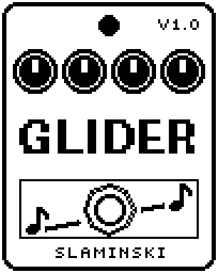

# Glider 1.00

A freeze with glide: every press of the footswitch holds the note you play, and the held sound slides from the old note to the new one.

- **Version:** 1.00
- **Files:** `GLIDER.ZD2` and `GLIDER.ZIC` (install both)
- **Played by:** your bass
- **On the pedal:** PITCH SHIFT, like every effect of this collection (see [About the files](../README.md#about-the-files))
- **Id:** `07000f84`
- **DSP load:** 77, as declared to the pedal (a patch on the MS-60B+ has room for 270)
- **Delay memory:** 40 KB
- **Tested on:** one Zoom MS-60B+, firmware 1.20 only (the same effect code, installed in its own category; see [About the files](../README.md#about-the-files))

## What it does

Glider holds the note that sounds when you press the footswitch, as a loop cut to whole periods of its pitch, like Freezer. The next freeze fades in over the old one (Atk, Rel), and with Gliss the held sound slides from the old note to the new one meanwhile. Chords and noise are held too, but they only crossfade unless Glider finds a single pitch in them. You keep playing over the held sound: Dry sets the level of your bass, Level the level of the held sound.

## Playing it

- With the defaults (FtSw on Next), play a note and press: it is held. Play another note and press again: the held sound slides to it in about 280 ms. Press with the strings muted to let go.
- Gliss 0 means no slide, only the crossfade; turn it up to 100 for slides of 4 s. The slide needs a single note in both freezes.
- Dry 0 leaves only the held sound. Tone darkens it, and Mod adds vibrato (Vib), tremolo (Trem) or a filter sweep (Filt).
- On Next the effect is never bypassed, whatever the LED shows. Set FtSw to OnOff if switching on should take a freeze and switching off should bypass the effect.

## Knobs

| Knob | Range | Default | What it does |
|---|---|---|---|
| `Frz` | Off, On | On | On: the effect holds a note and takes a new one each time the footswitch asks for one (see FtSw) or this knob goes from Off to On. Off: what is held fades away at the pace of Rel. |
| `Atk` | 0 to 100 | 30 | Attack: how long a freeze takes to fade in, 10 ms to 6 s (30 = 68 ms). |
| `Rel` | 0 to 100 | 50 | Release: how long a freeze takes to fade out, when Frz goes to Off or a new freeze comes in over it, 10 ms to 6 s (50 = 245 ms). |
| `Gliss` | 0 to 100 | 50 | The slide from the old held note to the new one: 0 = none, otherwise how long it takes, 20 ms to 4 s (50 = 280 ms). |
| `Dry` | 0 to 100 | 80 | Level of your bass while the effect is on. 80 = as loud as bypassed, 0 = only the held sound, 100 = 1.5 times. |
| `Tone` | 200 Hz to 12.0k Hz, Open | Open | Cutoff of a low-pass on the held sound. Open, the last step, is no low-pass at all. |
| `Level` | 0 to 100 | 40 | Level of the held sound. 80 = as loud as the note was, 40 = half as loud. |
| `FtSw` | OnOff, Next | Next | Next: every press takes a new freeze, and the effect is never bypassed. OnOff: switching on takes a freeze, switching off bypasses the effect. |
| `MType` | Vib, Trem, Filt | Vib | What Mod does to the held sound: Vib = its pitch sways, Trem = its level pulses, Filt = the Tone low-pass sweeps down from where Tone is and back up (also with Tone at Open). |
| `Mod` | 0 to 100 | 0 | Depth of the modulation, 0 = off. At 100: Vib half a semitone each way, Trem down to nothing, Filt five octaves down from Tone. |
| `MRate` | 0.100 Hz to 8.00 Hz | 0.58 Hz | Speed of the modulation. |

## Good to know

- Watch the level: the held sound adds to what you play. With Dry and Level at 80, the two together can be twice as loud as your bass alone; at Level 40 (the default), one and a half times. Keep that in mind for the effects after it.
- Known issue: a patch with Glider on, loaded while a note rings, holds that note. Mute the strings before you change patches; if a note is held anyway, press the footswitch once with the strings muted.
- Glider uses 40 KB of the pedal's delay memory. Without it, the bass passes and nothing is held. Every change to the chain (adding, removing or moving an effect) lets go of what is held.
- Glider needs more processing than most effects, so in a full chain the pedal may not have room for it.

## Installing

Read the safety notes in the [collection's README](../README.md#read-this-first) and stomphacks' [SAFETY.md](https://github.com/thammer/stomphacks/blob/main/SAFETY.md) first. Install with [stomphacks](https://github.com/thammer/stomphacks), from its folder, one command at a time, checking each result:

1. `.venv/bin/python3 tools-pedal/safe_connect.py session/` connects and confirms that AUTO SAVE is off.
2. `.venv/bin/python3 tools-pedal/backup_pedal.py backup/` backs up the pedal (once per pedal).
3. `.venv/bin/python3 tools-pedal/pedal_diy.py install <this folder>/GLIDER.ZD2 --dry-run`, then the same without `--dry-run`. It uploads `GLIDER.ZIC` alongside: keep it next to the `.ZD2`, without it pedal_diy.py refuses.
4. `.venv/bin/python3 tools-pedal/readback.py GLIDER.ZD2 session/GLIDER-back.ZD2` and `cmp <this folder>/GLIDER.ZD2 session/GLIDER-back.ZD2`: they must be identical.
5. Try it in an unsaved patch, with the amp or headphones turned down.

To update to a newer version: take the effect out of every patch, `pedal_diy.py uninstall <this folder>/GLIDER.ZD2` (the new file has the old one's name and id), then install the new one as in step 3 and read it back to a new path (for example `session/GLIDER-back2.ZD2`; readback.py does not overwrite a file). The effect appears under PITCH SHIFT on the pedal (see the collection's README).
