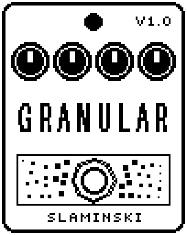

# Granular 1.00

A granular delay that replays the last third of a second of your bass as up to four overlapping grains, each from its own place, forwards or backwards, at a pitch you choose.

- **Version:** 1.00
- **Files:** `GRANULAR.ZD2` and `GRANULAR.ZIC` (install both)
- **Played by:** your bass
- **On the pedal:** PITCH SHIFT, like every effect of this collection (see [About the files](../README.md#about-the-files))
- **Id:** `07000f82`
- **DSP load:** 55, as declared to the pedal (a patch on the MS-60B+ has room for 270)
- **Delay memory:** 32 KB
- **Tested on:** one Zoom MS-60B+, firmware 1.20 only (the same effect code, installed in its own category; see [About the files](../README.md#about-the-files))

## What it does

Granular records your bass and plays it back in short slices, called grains, of 10 to 150 ms. Up to four grains sound at once, each starting at its own place in the last third of a second, picked partly by chance (Scat). A grain can play forwards or backwards (Rev), and all of them can be shifted up to an octave up or down (Pitch). Feedback sends the grains back into the delay, so with Pitch away from 0 every round is shifted again. Hold stops the recording, and the grains keep playing what the delay holds.

## Playing it

- Start with the defaults: three overlapping grains of about 51 ms at the pitch you play, under the unchanged bass.
- Set Pitch to +12 or -12 for grains an octave up or down. Raise Fdbk and every round is shifted once more.
- Short grains (low Size) buzz at their own rate, long ones are small loops. Dens at 1 makes the sound pulse; from 2 grains on they overlap.
- Turn Scat and Rev up for a more random, broken-up sound. Set Hold to On to keep the grains playing what was just recorded while you play something else over it.

## Knobs

| Knob | Range | Default | What it does |
|---|---|---|---|
| `Size` | 0 to 100 | 60 | Length of a grain, 10 to 150 ms (60 = 51 ms). Short grains buzz at their own rate, long ones are small loops. |
| `Dens` | 0 to 100 | 67 | How many grains sound at once, 1 to 4 (67 = 3). At 1 they follow one another and the sound pulses; from 2 on they overlap. |
| `Pitch` | -12 to +12 semitones | 0 semitones | Pitch of the grains: they are read faster or slower. |
| `Scat` | 0 to 100 | 30 | Scatter: how far back in time a grain may start, by chance. 0 = every grain plays what was just played; 100 = anything from the last third of a second. |
| `Rev` | 0 to 100 | 0 | Chance in percent that a grain plays backwards. |
| `Fdbk` | 0 to 100 | 30 | How much of the grains goes back into the delay, up to 90 %. With Pitch away from 0 every round is shifted again. |
| `Hold` | Off, On | Off | On: nothing new is recorded; the grains keep playing what the delay holds. |
| `Mix` | 0 to 100 | 35 | Up to 50 the grains come in under the unchanged bass; above 50 the bass goes down. 100 = grains only. |
| `Level` | 0 to 100 | 80 | Output level while the effect is on. 80 = as loud as it comes in. |

## Good to know

- The grains are mono and a little darker than your bass: they reach up to about 11 kHz.
- Granular uses 32 KB of the pedal's delay memory. Without it, the bass passes and there are no grains. Every change to the chain (adding, removing or moving an effect) empties the delay.

## Installing

Read the safety notes in the [collection's README](../README.md#read-this-first) and stomphacks' [SAFETY.md](https://github.com/thammer/stomphacks/blob/main/SAFETY.md) first. Install with [stomphacks](https://github.com/thammer/stomphacks), from its folder, one command at a time, checking each result:

1. `.venv/bin/python3 tools-pedal/safe_connect.py session/` connects and confirms that AUTO SAVE is off.
2. `.venv/bin/python3 tools-pedal/backup_pedal.py backup/` backs up the pedal (once per pedal).
3. `.venv/bin/python3 tools-pedal/pedal_diy.py install <this folder>/GRANULAR.ZD2 --dry-run`, then the same without `--dry-run`. It uploads `GRANULAR.ZIC` alongside: keep it next to the `.ZD2`, without it pedal_diy.py refuses.
4. `.venv/bin/python3 tools-pedal/readback.py GRANULAR.ZD2 session/GRANULAR-back.ZD2` and `cmp <this folder>/GRANULAR.ZD2 session/GRANULAR-back.ZD2`: they must be identical.
5. Try it in an unsaved patch, with the amp or headphones turned down.

To update to a newer version: take the effect out of every patch, `pedal_diy.py uninstall <this folder>/GRANULAR.ZD2` (the new file has the old one's name and id), then install the new one as in step 3 and read it back to a new path (for example `session/GRANULAR-back2.ZD2`; readback.py does not overwrite a file). The effect appears under PITCH SHIFT on the pedal (see the collection's README).
