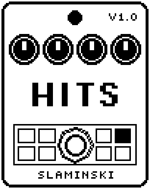

# Hits 1.00

A little sampler for the footswitch with eight one-shot sounds (orchestra hit, choir, gong, bell, clap, snare, tom and synth stab), added to your bass.

- **Version:** 1.00
- **Files:** `HITS.ZD2` and `HITS.ZIC` (install both)
- **Played by:** the footswitch
- **On the pedal:** PITCH SHIFT, like every effect of this collection (see [About the files](../README.md#about-the-files))
- **Id:** `07000f96`
- **DSP load:** 46, as declared to the pedal (a patch on the MS-60B+ has room for 270)
- **Delay memory:** none
- **Tested on:** one Zoom MS-60B+, firmware 1.20 only (the same effect code, installed in its own category; see [About the files](../README.md#about-the-files))

## What it does

Every press of the footswitch plays the chosen sound from the start, whatever the LED shows; a sound still ringing fades out in 3 ms first. The sounds are built into the effect, 0.37 s long each and played back at 11 kHz. With Pitch at Bass the sound is played at the note you played last, so the hit, the choir or the bell is tuned to your bass. Start, Len and Rev play a part of the sound or play it backwards. The bass passes unchanged; the sound is added.

## Playing it

- Choose a sound with Hit and press the footswitch. Every press is a command; the LED does not matter.
- With Pitch at Bass, press just after the note: the pitch tracker needs about 60 ms after a new note, so a press together with a new note still gets the note before.
- Tone takes off the grit the 11 kHz samples leave above 5 kHz.
- Drive makes the sound harder and louder (7 to 13 dB more at 100 than at 0): take Level back when you turn it up.

## Knobs

| Knob | Range | Default | What it does |
|---|---|---|---|
| `Hit` | Orch, Choir, Gong, Bell, Clap, Snare, Tom, Stab | Orch | The sound: an orchestra hit, a choir "aah" on A, a gong, a bell, a clap, a snare, a tom, or a synth chord that closes its filter. |
| `Pitch` | Fix, Bass | Fix | Fix: every sound at its own pitch, moved by Tune. Bass: played at the note you played last (folded into C2 to B2, moved by Oct). |
| `Oct` | -1, 0, +1 | 0 | With Pitch at Bass: the octave of the note, 0 = C2 to B2. Not used with Pitch at Fix. |
| `Tune` | 0 to 100 | 50 | Pitch: 50 = as the sound is, or on the note. 0 and 100 are 18 semitones lower and higher. |
| `Start` | 0 to 100 | 0 | Where in the sound it starts: 0 = the beginning, 100 = only its quiet last eighth. |
| `Len` | 0 to 100 | 100 | How much of it plays: 100 = to the end, 0 = only a few milliseconds. The end fades out over about 12 ms. |
| `Rev` | Off, On | Off | On: played backwards. |
| `Tone` | 1.50k Hz to 16.0k Hz | 7.87k Hz | Cutoff of a gentle low-pass on the sound. |
| `Drive` | 0 to 100 | 20 | Saturation: 0 = clean, 100 = very hard. |
| `Level` | 0 to 100 | 80 | Level of the sound. The bass is not affected. |

## Good to know

- You cannot load your own samples into Hits: the eight sounds are fixed.
- With Pitch at Bass, a sound that would have to go more than two octaves up or 60 semitones down (Oct +1 with a high Tune, Bell with Oct -1 and a low Tune) jumps by whole octaves and stays on the note.

## Installing

Read the safety notes in the [collection's README](../README.md#read-this-first) and stomphacks' [SAFETY.md](https://github.com/thammer/stomphacks/blob/main/SAFETY.md) first. Install with [stomphacks](https://github.com/thammer/stomphacks), from its folder, one command at a time, checking each result:

1. `.venv/bin/python3 tools-pedal/safe_connect.py session/` connects and confirms that AUTO SAVE is off.
2. `.venv/bin/python3 tools-pedal/backup_pedal.py backup/` backs up the pedal (once per pedal).
3. `.venv/bin/python3 tools-pedal/pedal_diy.py install <this folder>/HITS.ZD2 --dry-run`, then the same without `--dry-run`. It uploads `HITS.ZIC` alongside: keep it next to the `.ZD2`, without it pedal_diy.py refuses.
4. `.venv/bin/python3 tools-pedal/readback.py HITS.ZD2 session/HITS-back.ZD2` and `cmp <this folder>/HITS.ZD2 session/HITS-back.ZD2`: they must be identical.
5. Try it in an unsaved patch, with the amp or headphones turned down.

To update to a newer version: take the effect out of every patch, `pedal_diy.py uninstall <this folder>/HITS.ZD2` (the new file has the old one's name and id), then install the new one as in step 3 and read it back to a new path (for example `session/HITS-back2.ZD2`; readback.py does not overwrite a file). The effect appears under PITCH SHIFT on the pedal (see the collection's README).
