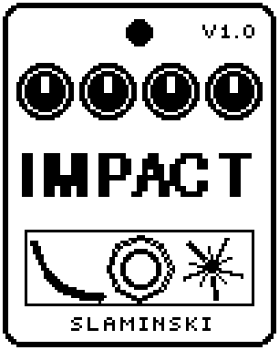

# Impact 1.00

Sound effects for the footswitch, added to your bass: a sub kick (808), a falling Drop, a Boom, a Riser, a Laser, a Siren and an Alarm.

- **Version:** 1.00
- **Files:** `IMPACT.ZD2` and `IMPACT.ZIC` (install both)
- **Played by:** the footswitch
- **On the pedal:** PITCH SHIFT, like every effect of this collection (see [About the files](../README.md#about-the-files))
- **Id:** `07000f8c`
- **DSP load:** 55, as declared to the pedal (a patch on the MS-60B+ has room for 270)
- **Delay memory:** none
- **Tested on:** one Zoom MS-60B+, firmware 1.20 only (the same effect code, installed in its own category; see [About the files](../README.md#about-the-files))

## What it does

Impact plays one of seven sounds when you press the footswitch. 808 is a sub kick with a long tail, Drop a sine that falls for seconds, Boom noise and a thump through a closing filter, and Laser a falling zap: these fire once and die away. Riser (noise and a rising tone), Siren (the pitch swings up and down) and Alarm (two beeping tones) start with one press and run until the next press, which fades them out in 100 ms. The bass passes unchanged; the sound is added.

## Playing it

- Every press of the footswitch is a command, whatever the LED shows. Pressing again during an 808, Drop, Boom or Laser fires it again from the start.
- Riser: the rise takes Len, then it holds until you press again, which lets it go.
- With Pitch at Bass, the sound is tuned to the note you played last when it starts. Riser, Siren and Alarm fade out on that note, even if you have played another one since.
- Drive makes the sound denser and louder on average while the peak stays the same: take Level back when you turn Drive up.

## Knobs

| Knob | Range | Default | What it does |
|---|---|---|---|
| `Sound` | 808, Drop, Boom, Riser, Laser, Siren, Alarm | 808 | The sound the footswitch plays (see above). |
| `Pitch` | Fix, Bass | Fix | Fix: every sound has its own note (808 around G1, Drop F#1, Boom E1, Riser C3, Laser G4, Siren C5, Alarm G5), moved by Tune. Bass: tuned to the note you played last, each sound in its own register. |
| `Tune` | 0 to 100 | 50 | Pitch: 50 = the sound's note, 0 and 100 are an octave below and above (about a quarter of a semitone per click). |
| `Len` | 0 to 100 | 55 | How long it lasts, 0.12 s to 8 s: the tail of 808 and Boom, the fall of Drop and Laser, the rise of the Riser. Not used by Siren and Alarm. |
| `Sweep` | 0 to 100 | 50 | How far the pitch travels: 808 up to 36 semitones, Drop and Riser 48, Laser 60, Siren swings up to 24. Boom: how far the filter opens. Alarm: how far the second tone is above the first, up to 12 semitones. |
| `Rate` | 0.30 Hz to 12.0 Hz | 1.31 Hz | Speed of Siren, Alarm and the Laser's wobble: one cycle is one up-and-down, one pair of beeps, one wobble. Not used by the others. |
| `Tone` | 0 to 100 | 50 | 808: the click at the start. Boom: noise against thump. Riser: noise against tone. Laser: how far the pitch wobbles. Not used by the others. |
| `Drive` | 0 to 100 | 30 | Saturation: 0 = clean, 100 = very hard. More Drive also makes the tails of 808, Boom and Laser last longer. |
| `Level` | 0 to 100 | 80 | Level of the sound. The bass is not affected. |

## Good to know

- In the first 0.2 s after you insert Impact or load a patch, a change of the LED does not count as a press.
- At Drive 100 the 808, Boom, Riser and Laser are about 8 to 11 dB louder on average than at Drive 0.

## Installing

Read the safety notes in the [collection's README](../README.md#read-this-first) and stomphacks' [SAFETY.md](https://github.com/thammer/stomphacks/blob/main/SAFETY.md) first. Install with [stomphacks](https://github.com/thammer/stomphacks), from its folder, one command at a time, checking each result:

1. `.venv/bin/python3 tools-pedal/safe_connect.py session/` connects and confirms that AUTO SAVE is off.
2. `.venv/bin/python3 tools-pedal/backup_pedal.py backup/` backs up the pedal (once per pedal).
3. `.venv/bin/python3 tools-pedal/pedal_diy.py install <this folder>/IMPACT.ZD2 --dry-run`, then the same without `--dry-run`. It uploads `IMPACT.ZIC` alongside: keep it next to the `.ZD2`, without it pedal_diy.py refuses.
4. `.venv/bin/python3 tools-pedal/readback.py IMPACT.ZD2 session/IMPACT-back.ZD2` and `cmp <this folder>/IMPACT.ZD2 session/IMPACT-back.ZD2`: they must be identical.
5. Try it in an unsaved patch, with the amp or headphones turned down.

To update to a newer version: take the effect out of every patch, `pedal_diy.py uninstall <this folder>/IMPACT.ZD2` (the new file has the old one's name and id), then install the new one as in step 3 and read it back to a new path (for example `session/IMPACT-back2.ZD2`; readback.py does not overwrite a file). The effect appears under PITCH SHIFT on the pedal (see the collection's README).
