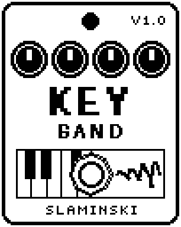

# KeyBand 1.00

A piano, electric piano, strings or brass for up to four notes at once, played from a MIDI keyboard.

- **Version:** 1.00
- **Files:** `KEYBAND.ZD2` and `KEYBAND.ZIC` (install both)
- **Played by:** a MIDI keyboard through the [MS Plus Bridge](https://github.com/skislaminski/MS-Plus-Bridge), up to four notes
- **On the pedal:** PITCH SHIFT, like every effect of this collection (see [About the files](../README.md#about-the-files))
- **Id:** `07000f94`
- **DSP load:** 86, as declared to the pedal (a patch on the MS-60B+ has room for 270)
- **Delay memory:** none
- **Tested on:** one Zoom MS-60B+, firmware 1.20 only (the same effect code, installed in its own category; see [About the files](../README.md#about-the-files))

## What it does

KeyBand turns the pedal into a small keyboard instrument: Voice picks a piano, an electric piano, strings or brass. Each of the knobs Key1 to Key4 is one voice, and the MS Plus Bridge gives every note you play one of them, with the velocity of your key on Vel. Every note is struck at once. Strings and brass swell in with Atk and share a low-pass filter that follows the highest note. While KeyBand is on you hear only the instrument; switched off, your bass passes unchanged.

## Playing it

- Choose a Voice and play chords: up to four notes sound together. A fifth note takes the voice of the oldest note.
- Piano and EPian: Atk sets the hammer (0 = hard and bright), Dec how long a held note rings, Tone the bite of the upper partials.
- Strings and brass pads: set Dec to 100 so a note holds as long as its key is down, and turn Atk up for a slow swell.
- Move adds an ensemble shimmer to strings and brass, and a slow beating to the pianos. At 0 the sound stays steady.
- To play the same instruments from your bass, one note at a time, use Orchestra.

## Knobs

| Knob | Range | Default | What it does |
|---|---|---|---|
| `Key1` | 0 to 1000 | 0 (off) | Gate and pitch of voice 1, written by the bridge: 0 = off, otherwise 10-cent steps above C0. A new note or a jump of a semitone or more is struck; a smaller move is a bend. |
| `Key2` | 0 to 1000 | 0 (off) | The same for voice 2. |
| `Key3` | 0 to 1000 | 0 (off) | The same for voice 3. |
| `Key4` | 0 to 1000 | 0 (off) | The same for voice 4. |
| `Voice` | Piano, EPian, Strng, Brass | Piano | The instrument of all four voices: piano, electric piano (a tine), strings (two detuned saws a note) or brass (strings with a filter that opens as the note swells in). |
| `Level` | 0 to 100 | 80 | The instrument's level: 80 = full level, 100 = 1.5 times, 0 = silent. |
| `Atk` | 0 to 100 | 30 | Strng: swell-in time, 3 ms to 2.5 s; Brass swells three times as fast. Piano and EPian: the hammer, 0 = hard and bright, 100 = soft and dull. |
| `Dec` | 0 to 100 | 50 | How long a held note rings, 0.3 s to 10 s. Strng and Brass: counted from the swell-in; 100 = the note holds as long as its key is down. |
| `Rel` | 0 to 100 | 35 | How fast a note is damped when you let go of its key, 20 ms to 4 s. A note let go never rings longer than the same note held. |
| `Tone` | 0 to 100 | 55 | Brightness. Strng and Brass: the cutoff of the shared low-pass. Piano and EPian: how loud the upper partials (the tine's bite) are. |
| `Move` | 0 to 100 | 40 | Strng and Brass: the two saws of a note detune against each other (up to 17 cents), with a vibrato that comes in with the swell. Piano and EPian: two strings a note that beat slowly. |
| `Vel` | 0 to 100 | 80 | How hard the next note is struck. The bridge writes your key's velocity here just before each note. |

## Good to know

- KeyBand is one of the heaviest effects here (see the DSP load above): leave room for it in a full chain.
- Very high notes: above E7 the electric piano's bite fades out (up to about C8).

## Installing

Read the safety notes in the [collection's README](../README.md#read-this-first) and stomphacks' [SAFETY.md](https://github.com/thammer/stomphacks/blob/main/SAFETY.md) first. Install with [stomphacks](https://github.com/thammer/stomphacks), from its folder, one command at a time, checking each result:

1. `.venv/bin/python3 tools-pedal/safe_connect.py session/` connects and confirms that AUTO SAVE is off.
2. `.venv/bin/python3 tools-pedal/backup_pedal.py backup/` backs up the pedal (once per pedal).
3. `.venv/bin/python3 tools-pedal/pedal_diy.py install <this folder>/KEYBAND.ZD2 --dry-run`, then the same without `--dry-run`. It uploads `KEYBAND.ZIC` alongside: keep it next to the `.ZD2`, without it pedal_diy.py refuses.
4. `.venv/bin/python3 tools-pedal/readback.py KEYBAND.ZD2 session/KEYBAND-back.ZD2` and `cmp <this folder>/KEYBAND.ZD2 session/KEYBAND-back.ZD2`: they must be identical.
5. Try it in an unsaved patch, with the amp or headphones turned down.

To update to a newer version: take the effect out of every patch, `pedal_diy.py uninstall <this folder>/KEYBAND.ZD2` (the new file has the old one's name and id), then install the new one as in step 3 and read it back to a new path (for example `session/KEYBAND-back2.ZD2`; readback.py does not overwrite a file). The effect appears under PITCH SHIFT on the pedal (see the collection's README).
