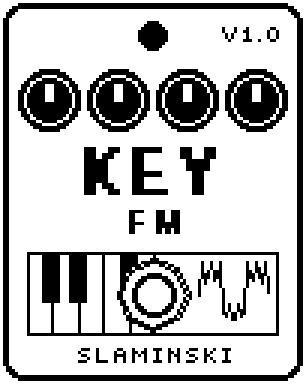

# KeyFM 1.00

An FM mono synth played from a MIDI keyboard: one sine modulates another, from a pure sine to bright, bell-like and metallic tones.

- **Version:** 1.00
- **Files:** `KEYFM.ZD2` and `KEYFM.ZIC` (install both)
- **Played by:** a MIDI keyboard through the [MS Plus Bridge](https://github.com/skislaminski/MS-Plus-Bridge)
- **On the pedal:** PITCH SHIFT, like every effect of this collection (see [About the files](../README.md#about-the-files))
- **Id:** `07000f72`
- **DSP load:** 20, as declared to the pedal (a patch on the MS-60B+ has room for 270)
- **Delay memory:** none
- **Tested on:** one Zoom MS-60B+, firmware 1.20 only (the same effect code, installed in its own category; see [About the files](../README.md#about-the-files))

## What it does

KeyFM makes its sound with frequency modulation: a modulator sine moves the phase of the sine you hear. Ratio sets the modulator's frequency against the note, Index how bright the sound gets, and an envelope (MEnv, MDcy) lets the brightness fade after each note. Whole-number ratios sound harmonic; the last four sound like bells and metal. While KeyFM is on you hear only the synth; switched off, your bass passes unchanged.

## Playing it

- Start with the defaults: a bright attack that fades towards a softer tone, like a struck note.
- For bells, choose Ratio 1.41, 2.72, 3.14 or 5.19 and turn MDcy and Rel up.
- For a tone that stays bright, set MEnv to 0. For a pure sine, set Index to 0.
- Fdbk turns the modulator from a sine towards a saw: the sound gets rougher.

## Knobs

| Knob | Range | Default | What it does |
|---|---|---|---|
| `Key` | 0 to 1000 | 0 (off) | Gate and pitch, written by the bridge: 0 = off, otherwise the pitch in 10-cent steps above C0, pitch bend included. |
| `Ratio` | 0.5, 1, 1.5, 2 to 10, 1.41, 2.72, 3.14, 5.19 | 1 | Frequency of the modulator against the note. Whole numbers sound harmonic, the last four like bells and metal. |
| `Index` | 0 to 100 | 55 | Depth of the modulation: 0 = a pure sine, 100 = very bright. High notes get less. |
| `MEnv` | 0 to 100 | 80 | How much of the Index follows the modulator envelope: 0 = the brightness stays, 100 = it fades away completely with MDcy. |
| `MDcy` | 0 to 100 | 40 | Decay of the modulator envelope, 5 ms to 4 s. 100 = it stays. |
| `Fdbk` | 0 to 100 | 20 | Feedback of the modulator onto itself: towards a saw, rougher. |
| `Atk` | 0 to 100 | 2 | Attack time of the level, 1 ms to 3 s. |
| `Rel` | 0 to 100 | 25 | Release time after you let go of the key, 1 ms to 3 s. |
| `Glide` | 0 to 100 | 0 (off) | Slide between tied notes, about 60 ms to 2 s. A note after a gap starts on its pitch. |
| `LFO` | Vib50 … Off … Trm50 | Off | Kind and depth in one: Vib = vibrato (up to ±100 cents), Trm = tremolo. The number is the depth. |
| `Rate` | 0.10 Hz to 20.0 Hz | 2.40 Hz | Speed of the LFO. |
| `Level` | 0 to 100 | 80 | Level of the synth: 80 = full level, 100 = 1.5 times, 0 = silent. |

## Good to know

- The footswitch switches KeyFM on and off; the pedal crossfades between the synth and your bass.
- A new note starts the modulator envelope again; a note you slide into (tied, Glide above 0) does not.
- High notes get less Index so they stay clean. With Fdbk and Index both turned high, high notes can still sound harsh.

## Installing

Read the safety notes in the [collection's README](../README.md#read-this-first) and stomphacks' [SAFETY.md](https://github.com/thammer/stomphacks/blob/main/SAFETY.md) first. Install with [stomphacks](https://github.com/thammer/stomphacks), from its folder, one command at a time, checking each result:

1. `.venv/bin/python3 tools-pedal/safe_connect.py session/` connects and confirms that AUTO SAVE is off.
2. `.venv/bin/python3 tools-pedal/backup_pedal.py backup/` backs up the pedal (once per pedal).
3. `.venv/bin/python3 tools-pedal/pedal_diy.py install <this folder>/KEYFM.ZD2 --dry-run`, then the same without `--dry-run`. It uploads `KEYFM.ZIC` alongside: keep it next to the `.ZD2`, without it pedal_diy.py refuses.
4. `.venv/bin/python3 tools-pedal/readback.py KEYFM.ZD2 session/KEYFM-back.ZD2` and `cmp <this folder>/KEYFM.ZD2 session/KEYFM-back.ZD2`: they must be identical.
5. Try it in an unsaved patch, with the amp or headphones turned down.

To update to a newer version: take the effect out of every patch, `pedal_diy.py uninstall <this folder>/KEYFM.ZD2` (the new file has the old one's name and id), then install the new one as in step 3 and read it back to a new path (for example `session/KEYFM-back2.ZD2`; readback.py does not overwrite a file). The effect appears under PITCH SHIFT on the pedal (see the collection's README).
