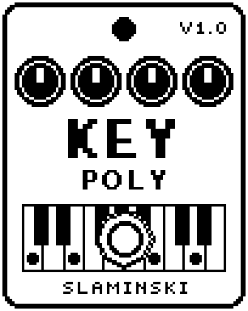

# KeyPoly 1.00

A four-voice synth for chords, played from a MIDI keyboard, with a shared resonant low-pass filter and an LFO.

- **Version:** 1.00
- **Files:** `KEYPOLY.ZD2` and `KEYPOLY.ZIC` (install both)
- **Played by:** a MIDI keyboard through the [MS Plus Bridge](https://github.com/skislaminski/MS-Plus-Bridge)
- **On the pedal:** PITCH SHIFT, like every effect of this collection (see [About the files](../README.md#about-the-files))
- **Id:** `07000f73`
- **DSP load:** 65, as declared to the pedal (a patch on the MS-60B+ has room for 270)
- **Delay memory:** none
- **Tested on:** one Zoom MS-60B+, firmware 1.20 only (the same effect code, installed in its own category; see [About the files](../README.md#about-the-files))

## What it does

KeyPoly plays up to four notes at once. Each of the knobs Key1 to Key4 is one voice, and the MS Plus Bridge gives every note you play one of them. All voices share the waveform, the attack and release, a resonant low-pass filter and the LFO; there is no glide and no filter envelope. While KeyPoly is on you hear only the synth; switched off, your bass passes unchanged.

## Playing it

- Start with the defaults: a bright saw for chords and stabs.
- For pads, choose Saw2 or Sqr2, turn Atk and Rel up, and Cutoff down a little.
- Set LFO to a Flt value to sweep the filter of all voices around Cutoff, up to two octaves each way.
- A fifth note takes the voice of the oldest note. Without the bridge, KeyPoly can only be played by turning Key1 to Key4 by hand.

## Knobs

| Knob | Range | Default | What it does |
|---|---|---|---|
| `Key1` | 0 to 1000 | 0 (off) | Gate and pitch of voice 1, written by the bridge: 0 = off, otherwise the pitch in 10-cent steps above C0, pitch bend included. |
| `Key2` | 0 to 1000 | 0 (off) | The same for voice 2. |
| `Key3` | 0 to 1000 | 0 (off) | The same for voice 3. |
| `Key4` | 0 to 1000 | 0 (off) | The same for voice 4. |
| `Wave` | Saw, Sqr, Saw2, Sqr2, SawSb, SqrSb, Saw5, SawOc, Tri, Sine | Saw | Waveform of all four voices. Saw2 and Sqr2 are two slightly apart, SawSb and SqrSb add a square an octave down, Saw5 and SawOc a saw a fifth or an octave up. |
| `Cutoff` | 33 Hz to 10.5k Hz | 1.86k Hz | Cutoff of the low-pass all voices share, one semitone a step. |
| `Reso` | 0 to 100 | 20 | Resonance of the low-pass. It stays just below self-oscillation. |
| `Atk` | 0 to 100 | 8 | Attack time of each voice, 1 ms to 3 s. |
| `Rel` | 0 to 100 | 45 | Release time of each voice after you let go of its key, 1 ms to 3 s. |
| `LFO` | Vib50 … Off … Flt50 | Off | Kind and depth in one: Vib = vibrato of all voices (up to ±100 cents), Flt = filter (cutoff up to ±2 octaves). |
| `Rate` | 0.10 Hz to 20.0 Hz | 2.40 Hz | Speed of the LFO. |
| `Level` | 0 to 100 | 80 | Level of the synth: 80 = full level, 100 = 1.5 times, 0 = silent. |

## Good to know

- The footswitch switches KeyPoly on and off; the pedal crossfades between the synth and your bass.
- Full chords with a lot of Reso are limited softly where they enter the filter and get a little grit.
- Changing Wave while notes sound switches at once and can click.
- The pedal shows Cutoff shortened to five letters until you select the knob.

## Installing

Read the safety notes in the [collection's README](../README.md#read-this-first) and stomphacks' [SAFETY.md](https://github.com/thammer/stomphacks/blob/main/SAFETY.md) first. Install with [stomphacks](https://github.com/thammer/stomphacks), from its folder, one command at a time, checking each result:

1. `.venv/bin/python3 tools-pedal/safe_connect.py session/` connects and confirms that AUTO SAVE is off.
2. `.venv/bin/python3 tools-pedal/backup_pedal.py backup/` backs up the pedal (once per pedal).
3. `.venv/bin/python3 tools-pedal/pedal_diy.py install <this folder>/KEYPOLY.ZD2 --dry-run`, then the same without `--dry-run`. It uploads `KEYPOLY.ZIC` alongside: keep it next to the `.ZD2`, without it pedal_diy.py refuses.
4. `.venv/bin/python3 tools-pedal/readback.py KEYPOLY.ZD2 session/KEYPOLY-back.ZD2` and `cmp <this folder>/KEYPOLY.ZD2 session/KEYPOLY-back.ZD2`: they must be identical.
5. Try it in an unsaved patch, with the amp or headphones turned down.

To update to a newer version: take the effect out of every patch, `pedal_diy.py uninstall <this folder>/KEYPOLY.ZD2` (the new file has the old one's name and id), then install the new one as in step 3 and read it back to a new path (for example `session/KEYPOLY-back2.ZD2`; readback.py does not overwrite a file). The effect appears under PITCH SHIFT on the pedal (see the collection's README).
