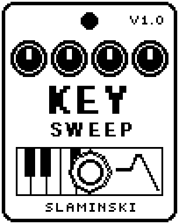

# KeySweep 1.00

A mono synth played from a MIDI keyboard, through a resonant 24 dB low-pass filter with its own envelope.

- **Version:** 1.00
- **Files:** `KEYSWEEP.ZD2` and `KEYSWEEP.ZIC` (install both)
- **Played by:** a MIDI keyboard through the [MS Plus Bridge](https://github.com/skislaminski/MS-Plus-Bridge)
- **On the pedal:** PITCH SHIFT, like every effect of this collection (see [About the files](../README.md#about-the-files))
- **Id:** `07000f71`
- **DSP load:** 52, as declared to the pedal (a patch on the MS-60B+ has room for 270)
- **Delay memory:** none
- **Tested on:** one Zoom MS-60B+, firmware 1.20 only (the same effect code, installed in its own category; see [About the files](../README.md#about-the-files))

## What it does

KeySweep is KeySynth's voice through a resonant low-pass filter (24 dB per octave). With every new note a filter envelope opens the filter above Cutoff and lets it close again, from a short pluck to a slow sweep. The cutoff follows the keyboard by half: an octave higher, the filter sits half an octave higher. An LFO adds vibrato or moves the filter. While KeySweep is on you hear only the synth; switched off, your bass passes unchanged.

## Playing it

- Start with the defaults: two saws slightly apart, and a filter that opens on every note and closes again.
- For a short, plucky synth bass, turn FDcy down and FEnv up. For a slow sweep, turn FDcy up; at 100 the filter stays open.
- More Reso makes the sweep sing. It stays just below the point where the filter would whistle by itself.
- With Glide above 0, notes you play legato slide and do not restart the filter envelope; a note after a gap restarts it.
- For a wobble, set LFO to a Flt value: it moves the cutoff up to two octaves each way at the speed of Rate.

## Knobs

| Knob | Range | Default | What it does |
|---|---|---|---|
| `Key` | 0 to 1000 | 0 (off) | Gate and pitch, written by the bridge: 0 = off, otherwise the pitch in 10-cent steps above C0, pitch bend included. |
| `Wave` | Saw, Sqr, Saw2, Sqr2, SawSb, SqrSb, Saw5, SawOc, Tri, Sine | Saw2 | The oscillators. Saw2 and Sqr2 are two slightly apart, SawSb and SqrSb add a square an octave down, Saw5 and SawOc a saw a fifth or an octave up. |
| `Cutoff` | 32.7 Hz to 10.5k Hz | 440 Hz | Cutoff of the low-pass, one semitone a step, shown for a note at C3. It follows the keyboard by half. |
| `Reso` | 0 to 100 | 35 | Resonance of the low-pass. It stays just below self-oscillation. |
| `FEnv` | 0 to 100 | 55 | How far the filter envelope opens the filter above Cutoff, up to six octaves. |
| `FDcy` | 0 to 100 | 45 | Decay of the filter envelope, 5 ms to 4 s. 100 = it stays open. |
| `Atk` | 0 to 100 | 5 | Attack time of the level, 1 ms to 3 s. |
| `Rel` | 0 to 100 | 30 | Release time after you let go of the key, 1 ms to 3 s. |
| `Glide` | 0 to 100 | 0 (off) | Slide between tied notes, about 60 ms to 2 s. |
| `LFO` | Vib50 … Off … Flt50 | Off | Kind and depth in one: Vib = vibrato (up to ±100 cents), Flt = filter (cutoff up to ±2 octaves). The number is the depth. |
| `Rate` | 0.10 Hz to 20.0 Hz | 2.40 Hz | Speed of the LFO. |
| `Level` | 0 to 100 | 80 | Level of the synth: 80 = full level, 100 = 1.5 times, 0 = silent. |

## Good to know

- The footswitch switches KeySweep on and off; the pedal crossfades between the synth and your bass.
- Changing Wave while a note sounds switches at once and can click.
- Right after a patch loads, a few knobs glide to their setting in about 60 ms. You hear it only on a note played in that moment.
- The pedal shows Cutoff shortened to five letters until you select the knob.

## Installing

Read the safety notes in the [collection's README](../README.md#read-this-first) and stomphacks' [SAFETY.md](https://github.com/thammer/stomphacks/blob/main/SAFETY.md) first. Install with [stomphacks](https://github.com/thammer/stomphacks), from its folder, one command at a time, checking each result:

1. `.venv/bin/python3 tools-pedal/safe_connect.py session/` connects and confirms that AUTO SAVE is off.
2. `.venv/bin/python3 tools-pedal/backup_pedal.py backup/` backs up the pedal (once per pedal).
3. `.venv/bin/python3 tools-pedal/pedal_diy.py install <this folder>/KEYSWEEP.ZD2 --dry-run`, then the same without `--dry-run`. It uploads `KEYSWEEP.ZIC` alongside: keep it next to the `.ZD2`, without it pedal_diy.py refuses.
4. `.venv/bin/python3 tools-pedal/readback.py KEYSWEEP.ZD2 session/KEYSWEEP-back.ZD2` and `cmp <this folder>/KEYSWEEP.ZD2 session/KEYSWEEP-back.ZD2`: they must be identical.
5. Try it in an unsaved patch, with the amp or headphones turned down.

To update to a newer version: take the effect out of every patch, `pedal_diy.py uninstall <this folder>/KEYSWEEP.ZD2` (the new file has the old one's name and id), then install the new one as in step 3 and read it back to a new path (for example `session/KEYSWEEP-back2.ZD2`; readback.py does not overwrite a file). The effect appears under PITCH SHIFT on the pedal (see the collection's README).
