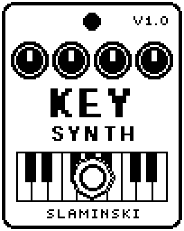

# KeySynth 1.00

A two-oscillator mono synth played from a MIDI keyboard, with glide and an LFO for vibrato or tremolo.

- **Version:** 1.00
- **Files:** `KEYSYNTH.ZD2` and `KEYSYNTH.ZIC` (install both)
- **Played by:** a MIDI keyboard through the [MS Plus Bridge](https://github.com/skislaminski/MS-Plus-Bridge)
- **On the pedal:** PITCH SHIFT, like every effect of this collection (see [About the files](../README.md#about-the-files))
- **Id:** `07000f61`
- **DSP load:** 48, as declared to the pedal (a patch on the MS-60B+ has room for 270)
- **Delay memory:** none
- **Tested on:** one Zoom MS-60B+, firmware 1.20 only (the same effect code, installed in its own category; see [About the files](../README.md#about-the-files))

## What it does

KeySynth is a monophonic synth voice with two oscillators (saw, square, triangle or sine), the second one up to two octaves away and finely detunable. Some settings of Wave1 bring a third oscillator along. The MS Plus Bridge writes every note you play, and the pitch wheel, into the Key knob. While KeySynth is on you hear only the synth; switched off, your bass passes unchanged.

## Playing it

- Start with the defaults: two saws, slightly detuned against each other, for a fat lead or synth bass.
- Set Pitch to +12 or -12 to stack an octave, or +7 for a fifth. Blend sets how much you hear of each oscillator.
- Glide above 0 slides between notes you play legato (tied). A note after a gap starts right on its pitch.
- Turning Key by hand also plays a note: a quick test without a keyboard.

## Knobs

| Knob | Range | Default | What it does |
|---|---|---|---|
| `Key` | 0 to 1000 | 0 (off) | Gate and pitch, written by the bridge: 0 = off, otherwise the pitch in 10-cent steps above C0, pitch bend included. |
| `Wave1` | Saw, Sqr, Saw2, Sqr2, SawSb, SqrSb, Saw5, SawOc, Tri, Sine | Saw | Waveform of oscillator 1. Saw2 and Sqr2 add a second one slightly apart, SawSb and SqrSb a square an octave down, Saw5 and SawOc a saw a fifth or an octave up. |
| `Wave2` | Off, Saw, Sqr, Tri, Sine | Saw | Waveform of oscillator 2, or Off. |
| `Pitch` | -24 to +24 semitones | 0 semitones | Pitch of oscillator 2 against oscillator 1. |
| `Dtune` | 0 to 100 | 12 | Fine detune of oscillator 2, 0 to +50 cents. |
| `Blend` | -50 to +50 | 0 | Balance of the oscillators: -50 = oscillator 1 alone, 0 = both alike, +50 = oscillator 2 alone. |
| `Glide` | 0 to 100 | 0 (off) | Slide between tied notes, about 60 ms to 2 s. |
| `Atk` | 0 to 100 | 5 | Attack time, 1 ms to 3 s. |
| `Rel` | 0 to 100 | 30 | Release time after you let go of the key, 1 ms to 3 s. |
| `LFO` | Vib50 … Off … Trm50 | Off | Kind and depth in one: Vib = vibrato (up to ±100 cents), Trm = tremolo. The number is the depth. |
| `Rate` | 0.100 Hz to 20.0 Hz | 2.40 Hz | Speed of the LFO. |
| `Level` | 0 to 100 | 80 | Level of the synth: 80 = full level, 100 = 1.5 times, 0 = silent. |

## Good to know

- The footswitch switches KeySynth on and off; the pedal crossfades between the synth and your bass.
- Changing Wave1 while a note sounds switches at once and can click.
- Right after a patch loads, a few knobs glide to their setting in about 60 ms. You hear it only on a note played in that moment.
- KeySynth 1.10 was published earlier on GitHub. This version 1.00 is newer: the effects of this collection start their numbering at 1.00 together. It replaces 1.10 (same id, same file names; uninstall the old one first). Patches saved with KeySynth 1.10 have their knobs in another order: set them again.
- KeySynth's set of features follows SYNTHESIS SYNx2 by Leemuzhko (https://github.com/Leemuzhko/Zoom-ZDL-FX/blob/main/zdl/sfx/synthesis/README.md), a synth effect for the older Zoom MS pedals; no code was taken from it.

## Installing

Read the safety notes in the [collection's README](../README.md#read-this-first) and stomphacks' [SAFETY.md](https://github.com/thammer/stomphacks/blob/main/SAFETY.md) first. Install with [stomphacks](https://github.com/thammer/stomphacks), from its folder, one command at a time, checking each result:

1. `.venv/bin/python3 tools-pedal/safe_connect.py session/` connects and confirms that AUTO SAVE is off.
2. `.venv/bin/python3 tools-pedal/backup_pedal.py backup/` backs up the pedal (once per pedal).
3. `.venv/bin/python3 tools-pedal/pedal_diy.py install <this folder>/KEYSYNTH.ZD2 --dry-run`, then the same without `--dry-run`. It uploads `KEYSYNTH.ZIC` alongside: keep it next to the `.ZD2`, without it pedal_diy.py refuses.
4. `.venv/bin/python3 tools-pedal/readback.py KEYSYNTH.ZD2 session/KEYSYNTH-back.ZD2` and `cmp <this folder>/KEYSYNTH.ZD2 session/KEYSYNTH-back.ZD2`: they must be identical.
5. Try it in an unsaved patch, with the amp or headphones turned down.

To update to a newer version: take the effect out of every patch, `pedal_diy.py uninstall <this folder>/KEYSYNTH.ZD2` (the new file has the old one's name and id), then install the new one as in step 3 and read it back to a new path (for example `session/KEYSYNTH-back2.ZD2`; readback.py does not overwrite a file). The effect appears under PITCH SHIFT on the pedal (see the collection's README).
