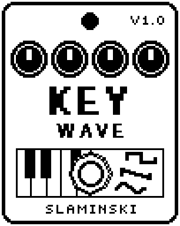

# KeyWave 1.00

A wavetable mono synth played from a MIDI keyboard, morphing between eight waveforms (from saw to square in the table it comes with).

- **Version:** 1.00
- **Files:** `KEYWAVE.ZD2` and `KEYWAVE.ZIC` (install both)
- **Played by:** a MIDI keyboard through the [MS Plus Bridge](https://github.com/skislaminski/MS-Plus-Bridge)
- **On the pedal:** PITCH SHIFT, like every effect of this collection (see [About the files](../README.md#about-the-files))
- **Id:** `07000f7c`
- **DSP load:** 32, as declared to the pedal (a patch on the MS-60B+ has room for 270)
- **Delay memory:** none
- **Tested on:** one Zoom MS-60B+, firmware 1.20 only (the same effect code, installed in its own category; see [About the files](../README.md#about-the-files))

## What it does

KeyWave's voice comes from a wavetable: a row of eight waveforms (frames), from a saw to a square in the table it comes with. Wave picks the place in the table and blends between neighbouring frames. Every new note can push that place along the table and let it fall back (WEnv, WDcy), and an LFO can move the place, the pitch or the level. Sub adds a sine one octave down. While KeyWave is on you hear only the synth; switched off, your bass passes unchanged.

## Playing it

- Play it from a MIDI keyboard through the MS Plus Bridge, or turn Key by hand. Then turn Wave slowly from 0 to 100 to hear the whole table.
- For movement on every note, turn WEnv above 50: each note starts further along the table and falls back at the pace of WDcy. Below 50 it moves towards the start.
- For a slowly changing tone, set LDest to Wave, LFO to about 30 and Rate below 1 Hz.
- Turn Sub up for more weight under the note.
- The app KeyWave Tables makes a KeyWave with a wavetable of your own (see below).

## Knobs

| Knob | Range | Default | What it does |
|---|---|---|---|
| `Key` | 0 to 1000 | 0 (off) | Gate and pitch, written by the bridge: 0 = off, otherwise the pitch in 10-cent steps above C0, pitch bend included. |
| `Wave` | 0 to 100 | 0 | Where in the table the voice plays: 0 = the first frame, 100 = the last, blended in between. |
| `WEnv` | 0 to 100 | 50 | How far every new note pushes the place in the table: 50 = not at all, 100 = to the end of the table, 0 = to its start. |
| `WDcy` | 0 to 100 | 60 | How fast that push falls back, 1 ms to 3 s (60 = 120 ms). |
| `Sub` | 0 to 100 | 0 | Level of a sine one octave below the note. |
| `Atk` | 0 to 100 | 10 | Attack time, 1 ms to 3 s. |
| `Rel` | 0 to 100 | 45 | Release time after you let go of the key, 1 ms to 3 s. |
| `Glide` | 0 to 100 | 0 (off) | Slide between tied notes, 20 ms to 0.7 s. |
| `LFO` | 0 to 100 | 0 (off) | Depth of the LFO on what LDest names. |
| `Rate` | 0.100 Hz to 20.0 Hz | 2.40 Hz | Speed of the LFO. |
| `LDest` | Wave, Pitch, Level | Wave | What the LFO moves: the place in the table (up to half the table each way), the pitch (up to a semitone each way) or the level (tremolo). |
| `Level` | 0 to 100 | 80 | Level of the synth: 80 = full level, 100 = 1.5 times, 0 = silent. |

## Good to know

- The footswitch switches KeyWave on and off; the pedal crossfades between the synth and your bass.
- With WDcy very short (under about 5 ms), the push of WEnv no longer reaches the end of the table.

## Your own wavetable: the app KeyWave Tables

KeyWave Tables puts a wavetable of your own into KeyWave without building the effect again. Drop a WAV file with single-cycle waveforms onto its window (or pick one of the examples), listen to the eight frames KeyWave will get, give it a name and make the effect. It writes a new `KEYWAVE.ZD2` and `KEYWAVE.ZIC`, which you install like any other effect (take KeyWave out of all patches and remove it first; knobs and saved settings stay the same). The app never talks to the pedal.

It is in this folder, for Mac and for Windows:

- **Mac** (one app for Apple silicon and Intel, macOS 12 or newer): unzip `KeyWave-Tables-1.1-Mac.zip` and open `KeyWave Tables.app`. It is not signed by a registered developer: on the first start, right-click it and choose Open (on macOS 15: System Settings, Privacy & Security, Open Anyway). Tested on macOS 15 on Apple silicon only (the Intel part under Rosetta).
- **Windows** (10 or 11, x64): unzip `KeyWave-Tables-1.1-Windows-x64.zip` and double-click `KeyWave Tables.bat`; nothing needs to be installed. Its window opens in Microsoft Edge. This version has not been run on Windows yet.

The file it makes carries the same MS-60B+ header as the KeyWave here, so you install it the same way. Each zip holds a `README.md` with the details and the licences of the software inside.

## Installing

Read the safety notes in the [collection's README](../README.md#read-this-first) and stomphacks' [SAFETY.md](https://github.com/thammer/stomphacks/blob/main/SAFETY.md) first. Install with [stomphacks](https://github.com/thammer/stomphacks), from its folder, one command at a time, checking each result:

1. `.venv/bin/python3 tools-pedal/safe_connect.py session/` connects and confirms that AUTO SAVE is off.
2. `.venv/bin/python3 tools-pedal/backup_pedal.py backup/` backs up the pedal (once per pedal).
3. `.venv/bin/python3 tools-pedal/pedal_diy.py install <this folder>/KEYWAVE.ZD2 --dry-run`, then the same without `--dry-run`. It uploads `KEYWAVE.ZIC` alongside: keep it next to the `.ZD2`, without it pedal_diy.py refuses.
4. `.venv/bin/python3 tools-pedal/readback.py KEYWAVE.ZD2 session/KEYWAVE-back.ZD2` and `cmp <this folder>/KEYWAVE.ZD2 session/KEYWAVE-back.ZD2`: they must be identical.
5. Try it in an unsaved patch, with the amp or headphones turned down.

To update to a newer version: take the effect out of every patch, `pedal_diy.py uninstall <this folder>/KEYWAVE.ZD2` (the new file has the old one's name and id), then install the new one as in step 3 and read it back to a new path (for example `session/KEYWAVE-back2.ZD2`; readback.py does not overwrite a file). The effect appears under PITCH SHIFT on the pedal (see the collection's README).
