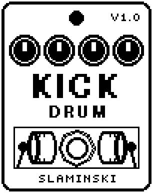

# Kick 1.00

An analog-style bass drum and tom, hit by every pluck of your bass; the bass passes unchanged and the drum is added.

- **Version:** 1.00
- **Files:** `KICK.ZD2` and `KICK.ZIC` (install both)
- **Played by:** your bass (or the Key knob by hand)
- **On the pedal:** PITCH SHIFT, like every effect of this collection (see [About the files](../README.md#about-the-files))
- **Id:** `07000f7b`
- **DSP load:** 15, as declared to the pedal (a patch on the MS-60B+ has room for 270)
- **Delay memory:** none
- **Tested on:** one Zoom MS-60B+, firmware 1.20 only (the same effect code, installed in its own category; see [About the files](../README.md#about-the-files))

## What it does

Kick is an analog-style drum: a sine wave whose pitch starts high and falls fast, a short click of noise at the start, and a saturator. With Trig on Bass, every pluck louder than Thr hits the drum. With Trig on Key, every new note on the Key knob hits it, tuned to that note. Your bass passes as it is; there is no Dry knob.

## Playing it

- Start with the defaults and pluck: every note gets a long, deep kick on G1 (49 Hz).
- For a shorter kick, turn Decay down; turn Click up for more attack. Sweep and PDcy set how far and how fast the pitch falls.
- Choose Mode Tom for a tom: an octave higher, and its pitch falls half as far. Tune sets where it lands.
- If the drum fires on string noise, raise Thr; if it misses soft notes, lower it.
- Leave Trig on Bass: the Key knob is made for a keyboard controller, but the MS Plus Bridge does not play Kick yet.

## Knobs

| Knob | Range | Default | What it does |
|---|---|---|---|
| `Key` | 0 to 1000 | 0 | Gate and pitch for a keyboard controller, as on KeySynth: 0 = off, every step 10 cents above C0. With Trig on Key every new note hits the drum, tuned to that note. |
| `Level` | 0 to 100 | 80 | Level of the drum, 80 = its normal level. The bass is not affected. |
| `Trig` | Key, Bass | Bass | What hits the drum. Key: every new note on the Key knob. Bass: every pluck louder than Thr. |
| `Mode` | Kick, Tom | Kick | Tom is an octave higher and its pitch falls half as far. |
| `Tune` | 0 to 100 | 50 | Pitch the drum ends on. 50 = the key played (Trig Key) or G1, 49 Hz (Trig Bass); 0 and 100 are an octave below and above. |
| `Sweep` | 0 to 100 | 50 | How far above that pitch the drum starts: 0 = not at all, 50 = two octaves, 100 = four. |
| `PDcy` | 0 to 100 | 45 | How fast the pitch falls, 3 ms to 300 ms (45 = 24 ms). |
| `Decay` | 0 to 100 | 55 | How long the drum sounds until it is 60 dB down, 0.14 s to 17 s (55 = 2 s). |
| `Click` | 0 to 100 | 30 | Level of the short noise burst at the start. |
| `Drive` | 0 to 100 | 20 | Saturation: the drum gets fatter and holds its level longer. A loud Click is tamed. |
| `Thr` | 0 to 100 | 40 | Trig Bass: how hard a pluck must be to hit the drum. |

## Good to know

- With Trig on Bass the drum does not follow your notes: it always lands on the pitch Tune sets.
- Drive 100 makes the drum ring about a quarter longer than Decay says.

## Installing

Read the safety notes in the [collection's README](../README.md#read-this-first) and stomphacks' [SAFETY.md](https://github.com/thammer/stomphacks/blob/main/SAFETY.md) first. Install with [stomphacks](https://github.com/thammer/stomphacks), from its folder, one command at a time, checking each result:

1. `.venv/bin/python3 tools-pedal/safe_connect.py session/` connects and confirms that AUTO SAVE is off.
2. `.venv/bin/python3 tools-pedal/backup_pedal.py backup/` backs up the pedal (once per pedal).
3. `.venv/bin/python3 tools-pedal/pedal_diy.py install <this folder>/KICK.ZD2 --dry-run`, then the same without `--dry-run`. It uploads `KICK.ZIC` alongside: keep it next to the `.ZD2`, without it pedal_diy.py refuses.
4. `.venv/bin/python3 tools-pedal/readback.py KICK.ZD2 session/KICK-back.ZD2` and `cmp <this folder>/KICK.ZD2 session/KICK-back.ZD2`: they must be identical.
5. Try it in an unsaved patch, with the amp or headphones turned down.

To update to a newer version: take the effect out of every patch, `pedal_diy.py uninstall <this folder>/KICK.ZD2` (the new file has the old one's name and id), then install the new one as in step 3 and read it back to a new path (for example `session/KICK-back2.ZD2`; readback.py does not overwrite a file). The effect appears under PITCH SHIFT on the pedal (see the collection's README).
