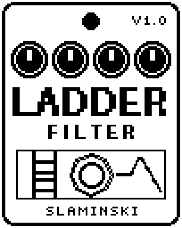

# Ladder 1.00

A four-pole analog-style low-pass filter for bass, with resonance up to self-oscillation, an envelope that opens it as you dig in, and an LFO.

- **Version:** 1.00
- **Files:** `LADDER.ZD2` and `LADDER.ZIC` (install both)
- **Played by:** your bass
- **On the pedal:** PITCH SHIFT, like every effect of this collection (see [About the files](../README.md#about-the-files))
- **Id:** `07000f7a`
- **DSP load:** 40, as declared to the pedal (a patch on the MS-60B+ has room for 270)
- **Delay memory:** none
- **Tested on:** one Zoom MS-60B+, firmware 1.20 only (the same effect code, installed in its own category; see [About the files](../README.md#about-the-files))

## What it does

Ladder runs your bass through a resonant low-pass filter of four stages (24 dB per octave, or 12 dB with Poles at 2Pole). The stages saturate a little when you hit them hard, as in an analog ladder filter. Playing harder moves the cutoff (Amnt), and an LFO can sweep it slowly or quickly. The low end stays full when you turn the resonance up.

## Playing it

- Start with the defaults: a warm, slightly squelchy filter that opens a little when you pluck harder.
- For an envelope filter ("quack"), set Cutoff low (around 150 Hz), Reso 60 to 80, Amnt +35 or more, and Follw high for fast funk lines.
- For a slow sweep, set Amnt to 0, LFO to 50 and Rate below 1 Hz.
- From Reso 91 on the filter sings on its own at the cutoff frequency. Turn Level or the amp down before you try it.

## Knobs

| Knob | Range | Default | What it does |
|---|---|---|---|
| `Cutoff` | 20 Hz to 12.0k Hz | 356 Hz | Cutoff frequency at rest, before the envelope and the LFO move it. |
| `Reso` | 0 to 100 | 40 | Resonance. From about 91 the filter sings by itself. |
| `Poles` | 2Pole, 4Pole | 4Pole | 2Pole: 12 dB per octave, brighter, the resonance stands out more. 4Pole: 24 dB per octave. |
| `Drive` | 0 to 100 | 20 | How hard the bass hits the filter stages, which saturate. The level behind the filter is taken back to match. |
| `Amnt` | -50 to +50 | +25 | Envelope amount: how far playing harder moves the cutoff. 0 = off, + = up, - = down, up to five octaves at ±50. |
| `Follw` | 0 to 100 | 55 | How fast the envelope follows your playing: 0 = slow and smooth (falls back in 2 s), 100 = fast (20 ms). |
| `LFO` | 0 to 100 | 0 | Depth of the LFO on the cutoff: 100 = a good two octaves up and down. 0 = off. |
| `Rate` | 0.050 Hz to 20.0 Hz | 0.41 Hz | Speed of the LFO. |
| `Mix` | 0 to 100 | 100 | 0 = the dry bass only, 100 = the filter only. |
| `Level` | 0 to 100 | 80 | Output level. 80 = as loud as it comes in. |

## Good to know

- Switching Poles crossfades in about 30 ms, so it does not click.
- The envelope rises twenty times as fast as it falls and waits a moment before it falls, so low notes do not make the filter wobble.
- The pedal shows Cutoff shortened to five letters until you select the knob.

## Installing

Read the safety notes in the [collection's README](../README.md#read-this-first) and stomphacks' [SAFETY.md](https://github.com/thammer/stomphacks/blob/main/SAFETY.md) first. Install with [stomphacks](https://github.com/thammer/stomphacks), from its folder, one command at a time, checking each result:

1. `.venv/bin/python3 tools-pedal/safe_connect.py session/` connects and confirms that AUTO SAVE is off.
2. `.venv/bin/python3 tools-pedal/backup_pedal.py backup/` backs up the pedal (once per pedal).
3. `.venv/bin/python3 tools-pedal/pedal_diy.py install <this folder>/LADDER.ZD2 --dry-run`, then the same without `--dry-run`. It uploads `LADDER.ZIC` alongside: keep it next to the `.ZD2`, without it pedal_diy.py refuses.
4. `.venv/bin/python3 tools-pedal/readback.py LADDER.ZD2 session/LADDER-back.ZD2` and `cmp <this folder>/LADDER.ZD2 session/LADDER-back.ZD2`: they must be identical.
5. Try it in an unsaved patch, with the amp or headphones turned down.

To update to a newer version: take the effect out of every patch, `pedal_diy.py uninstall <this folder>/LADDER.ZD2` (the new file has the old one's name and id), then install the new one as in step 3 and read it back to a new path (for example `session/LADDER-back2.ZD2`; readback.py does not overwrite a file). The effect appears under PITCH SHIFT on the pedal (see the collection's README).
