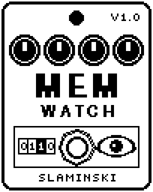

# MemWatch 1.00

A measuring tool that watches its delay memory and tells you by sound whether another effect writes into it, and how much delay memory the pedal offers.

- **Version:** 1.00
- **Files:** `MEMWATCH.ZD2` and `MEMWATCH.ZIC` (install both)
- **Played by:** nothing to play: a measuring tool, not needed for playing
- **On the pedal:** PITCH SHIFT, like every effect of this collection (see [About the files](../README.md#about-the-files))
- **Id:** `07000f77`
- **DSP load:** 15, as declared to the pedal (a patch on the MS-60B+ has room for 270)
- **Delay memory:** 40 KB
- **Tested on:** one Zoom MS-60B+, firmware 1.20 only (the same effect code, installed in its own category; see [About the files](../README.md#about-the-files))

## What it does

MemWatch makes no sound of its own: your bass passes unchanged. It fills its delay memory with a fixed value and keeps checking that nobody else writes there. If somebody does, the bass pulsates: fast while it goes on, slowly afterwards. If there is no usable delay memory, or less than Size asks for, you hear silence. With Span it also shows how much delay memory the pedal offers.

## Playing it

- Put MemWatch in an unsaved patch with the effects you want to check, and play. The bass as it is means clean; pulsing means somebody wrote into MemWatch's memory.
- Size sets how much memory is watched. For comparison: Orchestra uses 3.5K, Wider and Dimension 4K, Organum 16K, Pluck 19.5K (set 20K to cover it), OSCDLY, Granular, Freezer and Cloud 32K, Glider 40K.
- With two MemWatch in one chain, set one to Mark 0 and the other to Mark 1. Then each notices the other if they share memory.
- To read how much delay memory the pedal offers, switch the effect on and turn Span up until the bass goes away.

## Knobs

| Knob | Range | Default | What it does |
|---|---|---|---|
| `Size` | 4K, 8K, 16K, 20K, 32K, 40K (4096 to 40000 bytes) | 40K | How much of the delay memory is filled and watched, from its start. Changing it starts over. |
| `Mark` | 0, 1 | 1 | Which of two values fills the memory. Either one notices somebody who writes there, even somebody who writes silence. Changing it starts over. |
| `Span` | Off, 20K, 32K, 64K, 128K, 256K, 512K, 1M, 2M, 4M (bytes) | Off | Mutes the bass when the pedal offers less delay memory than this. Nothing beyond Size is touched. |

## Good to know

- MemWatch is not needed for playing; do not save a patch with it.
- Without usable delay memory MemWatch mutes your bass, even when it is switched off (LED off). That is on purpose: silence while it is off shows that the pedal gives no delay memory to a switched-off effect.
- The silence from Span only comes while the effect is on.
- When it finds a foreign value, MemWatch writes its own back, so it can disturb an effect that shares its memory. That disturbance is then part of the proof, not a new fault.
- On the MS-60B+ it never pulsed, alone or next to other delays, reverbs and a second MemWatch, and Span 1M was the last setting with sound: every effect gets delay memory of its own, between 1 and 2 MB.

## Installing

Read the safety notes in the [collection's README](../README.md#read-this-first) and stomphacks' [SAFETY.md](https://github.com/thammer/stomphacks/blob/main/SAFETY.md) first. Install with [stomphacks](https://github.com/thammer/stomphacks), from its folder, one command at a time, checking each result:

1. `.venv/bin/python3 tools-pedal/safe_connect.py session/` connects and confirms that AUTO SAVE is off.
2. `.venv/bin/python3 tools-pedal/backup_pedal.py backup/` backs up the pedal (once per pedal).
3. `.venv/bin/python3 tools-pedal/pedal_diy.py install <this folder>/MEMWATCH.ZD2 --dry-run`, then the same without `--dry-run`. It uploads `MEMWATCH.ZIC` alongside: keep it next to the `.ZD2`, without it pedal_diy.py refuses.
4. `.venv/bin/python3 tools-pedal/readback.py MEMWATCH.ZD2 session/MEMWATCH-back.ZD2` and `cmp <this folder>/MEMWATCH.ZD2 session/MEMWATCH-back.ZD2`: they must be identical.
5. Try it in an unsaved patch, with the amp or headphones turned down.

To update to a newer version: take the effect out of every patch, `pedal_diy.py uninstall <this folder>/MEMWATCH.ZD2` (the new file has the old one's name and id), then install the new one as in step 3 and read it back to a new path (for example `session/MEMWATCH-back2.ZD2`; readback.py does not overwrite a file). The effect appears under PITCH SHIFT on the pedal (see the collection's README).
