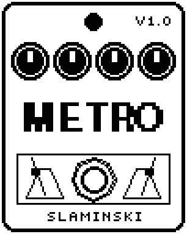

# Metro 1.00

A metronome with an accent on the first click of the bar, in the tempo of the patch or at its own, with a practice mode that mutes bars.

- **Version:** 1.00
- **Files:** `METRO.ZD2` and `METRO.ZIC` (install both)
- **Played by:** the footswitch
- **On the pedal:** PITCH SHIFT, like every effect of this collection (see [About the files](../README.md#about-the-files))
- **Id:** `07000f95`
- **DSP load:** 26, as declared to the pedal (a patch on the MS-60B+ has room for 270)
- **Delay memory:** none
- **Tested on:** one Zoom MS-60B+, firmware 1.20 only (the same effect code, installed in its own category; see [About the files](../README.md#about-the-files))

## What it does

Metro clicks the beats of a bar, in meters from 2/4 to 7/8, with an accent on the first click that is louder and higher. Sub adds softer clicks between the beats, and Sound chooses a wood knock, a beep, a click or a cowbell. Train mutes the clicks for some bars so that you keep the time alone. The bass passes unchanged; the clicks are added.

## Playing it

- After you insert it, load a patch or change the chain, Metro is silent, even with the LED on. Switch it off and on once. Save the patch with Metro switched off: then one press starts it.
- LED on starts on beat 1, with the accent at once. LED off stops it; a click still sounding rings out.
- Leave Tempo on Sync and set the tempo with the BPM module or by tap, or choose your own tempo with the Tempo knob. One click is one beat.
- To practise, set Train: 3+1 gives three bars with clicks and one without. Train counts its bars from the start; the first bar always has clicks.
- You can change Sub while Metro runs: the beats and the one stay where they were.

## Knobs

| Knob | Range | Default | What it does |
|---|---|---|---|
| `Meter` | 2/4, 3/4, 4/4, 5/4, 6/8, 7/8 | 4/4 | Clicks per bar and where the accents sit. 6/8 has a second, lighter accent on the fourth click, 7/8 one on the fifth (4+3). |
| `Tempo` | 40 to 250 BPM, Sync | Sync | Sync: the tempo of the patch (BPM module, tap). 40 to 250: its own tempo in BPM. |
| `Level` | 0 to 100 | 80 | Level of the clicks. The bass is not affected. |
| `Sub` | Off, 8th, Trip, 16th | Off | Softer clicks between the beats: one (8th), two (Trip) or three (16th). |
| `Sound` | Wood, Beep, Click, Cow | Wood | Wood: a short wooden knock. Beep: a clear beep. Click: a dry click of noise and a high tone. Cow: a cowbell. |
| `Tune` | 0 to 100 | 50 | Pitch of the click: 50 = as the sound is, 0 and 100 an octave lower and higher. |
| `Acc` | 0 to 100 | 60 | How much stronger the first click of the bar is: 0 = all alike, 100 = the others half as loud. |
| `Train` | Off, 1+1, 2+2, 3+1, 4+4 | Off | Bars with clicks, then bars without: 1+1, 2+2, 3+1 (three with, one without) or 4+4. |

## Good to know

- With Tempo on Sync, a new patch tempo may only arrive once you move the Tempo knob.
- Inserting or moving an effect in the chain while it plays makes Metro silent again: switch it off and on once.
- DrumBox has a metronome too: its pattern Click, with a count-in.

## Installing

Read the safety notes in the [collection's README](../README.md#read-this-first) and stomphacks' [SAFETY.md](https://github.com/thammer/stomphacks/blob/main/SAFETY.md) first. Install with [stomphacks](https://github.com/thammer/stomphacks), from its folder, one command at a time, checking each result:

1. `.venv/bin/python3 tools-pedal/safe_connect.py session/` connects and confirms that AUTO SAVE is off.
2. `.venv/bin/python3 tools-pedal/backup_pedal.py backup/` backs up the pedal (once per pedal).
3. `.venv/bin/python3 tools-pedal/pedal_diy.py install <this folder>/METRO.ZD2 --dry-run`, then the same without `--dry-run`. It uploads `METRO.ZIC` alongside: keep it next to the `.ZD2`, without it pedal_diy.py refuses.
4. `.venv/bin/python3 tools-pedal/readback.py METRO.ZD2 session/METRO-back.ZD2` and `cmp <this folder>/METRO.ZD2 session/METRO-back.ZD2`: they must be identical.
5. Try it in an unsaved patch, with the amp or headphones turned down.

To update to a newer version: take the effect out of every patch, `pedal_diy.py uninstall <this folder>/METRO.ZD2` (the new file has the old one's name and id), then install the new one as in step 3 and read it back to a new path (for example `session/METRO-back2.ZD2`; readback.py does not overwrite a file). The effect appears under PITCH SHIFT on the pedal (see the collection's README).
