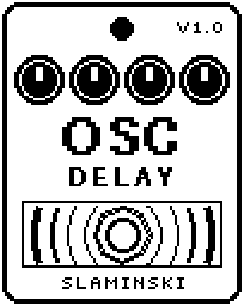

# OSCDLY 1.00

A short delay whose feedback goes past 100 %, so the repeats build up and sing by themselves, held in check by a limiter and darkened by a low-pass in the loop.

- **Version:** 1.00
- **Files:** `OSCDLY.ZD2` and `OSCDLY.ZIC` (install both)
- **Played by:** your bass
- **On the pedal:** PITCH SHIFT, like every effect of this collection (see [About the files](../README.md#about-the-files))
- **Id:** `07000f7e`
- **DSP load:** 40, as declared to the pedal (a patch on the MS-60B+ has room for 270)
- **Delay memory:** 32 KB
- **Tested on:** one Zoom MS-60B+, firmware 1.20 only (the same effect code, installed in its own category; see [About the files](../README.md#about-the-files))

## What it does

OSCDLY is a delay of 20 to 181 ms, or 40 to 363 ms with Rate on Half. Its feedback goes up to 120 %: above 100 % the repeats no longer die away but grow until a limiter in the loop holds them, and the delay sings by itself. A low-pass in the loop (Tone) makes every repeat darker than the one before. Changing Time bends the pitch of the repeats, as on a tape delay.

## Playing it

- Start with the defaults: repeats every 94 ms, each quieter and darker than the one before, at half the level of your bass.
- To make it sing, play a note and set Osc to On, or turn Fdbk a few clicks above 83. Back on Off, the repeats die away at the pace Fdbk sets. The loop needs a note to feed on: an empty delay stays silent.
- With Osc on FtSw, the footswitch switches the singing on and off. The delay then stays on all the time, and the LED shows whether the loop sings.
- Turn Time while the loop sings for tape-style pitch bends. Sat sets how loud a singing loop gets: higher Sat distorts sooner and keeps the loop quieter.

## Knobs

| Knob | Range | Default | What it does |
|---|---|---|---|
| `Time` | 0 to 100 | 70 | Delay time: 20 to 181 ms with Rate on Full, 40 to 363 ms on Half (70 = 94 or 188 ms). A new setting is reached over about half a second, and the pitch of the repeats bends on the way. |
| `Fdbk` | 0 to 100 | 50 | Feedback, 0 to 120 %. 83 is 100 %; a few clicks above that the repeats stop dying away and grow until the limiter holds them. |
| `Mix` | 0 to 100 | 25 | Up to 50 the repeats come in under the unchanged bass (25 = half as loud as the bass); above 50 the bass goes down. 100 = repeats only. |
| `Osc` | Off, On, FtSw | Off | On: the loop sings, whatever Fdbk says. Off: the repeats die away at the pace Fdbk sets. FtSw: the footswitch switches between the two. |
| `Tone` | 400 Hz to 12.0k Hz | 3.08k Hz | Cutoff of the low-pass in the loop. Every repeat is darker than the one before. |
| `Sat` | 0 to 100 | 30 | How early the limiter in the loop sets in. Higher: the repeats distort sooner and a singing loop stays quieter. |
| `Mod` | 0 to 100 | 0 | An LFO moves the delay time, up to 1.5 ms each way (3 ms on Half): chorus on the repeats, seasick at high MRate. 0 = off. |
| `MRate` | 0.100 Hz to 6.00 Hz | 0.51 Hz | Speed of that LFO. |
| `Rate` | Full, Half | Full | Half: twice the time, and the repeats lose everything above 8 kHz and gain some grit. Switching empties the delay. |
| `Level` | 0 to 100 | 80 | Output level while the effect is on. 80 = as loud as it comes in. |

## Good to know

- The repeats are mono.
- Switched off (with Osc on Off or On), the delay records nothing and a singing loop dies away, so switching it on again starts with an empty delay.
- OSCDLY uses 32 KB of the pedal's delay memory. Without it, the bass passes and there are no repeats. Every change to the chain (adding, removing or moving an effect) empties the delay.
- Watch the level: with Fdbk a few clicks above 83, or Osc On, the loop sings on its own and goes on after you stop playing, until you set Osc to Off, turn Fdbk down or switch the effect off. The lower Sat, the louder it sings. Turn the amp down before you try it.
- Turning Time back and forth at high Fdbk bends the pitch again every round, so the bends build up, as on a tape echo.

## Installing

Read the safety notes in the [collection's README](../README.md#read-this-first) and stomphacks' [SAFETY.md](https://github.com/thammer/stomphacks/blob/main/SAFETY.md) first. Install with [stomphacks](https://github.com/thammer/stomphacks), from its folder, one command at a time, checking each result:

1. `.venv/bin/python3 tools-pedal/safe_connect.py session/` connects and confirms that AUTO SAVE is off.
2. `.venv/bin/python3 tools-pedal/backup_pedal.py backup/` backs up the pedal (once per pedal).
3. `.venv/bin/python3 tools-pedal/pedal_diy.py install <this folder>/OSCDLY.ZD2 --dry-run`, then the same without `--dry-run`. It uploads `OSCDLY.ZIC` alongside: keep it next to the `.ZD2`, without it pedal_diy.py refuses.
4. `.venv/bin/python3 tools-pedal/readback.py OSCDLY.ZD2 session/OSCDLY-back.ZD2` and `cmp <this folder>/OSCDLY.ZD2 session/OSCDLY-back.ZD2`: they must be identical.
5. Try it in an unsaved patch, with the amp or headphones turned down.

To update to a newer version: take the effect out of every patch, `pedal_diy.py uninstall <this folder>/OSCDLY.ZD2` (the new file has the old one's name and id), then install the new one as in step 3 and read it back to a new path (for example `session/OSCDLY-back2.ZD2`; readback.py does not overwrite a file). The effect appears under PITCH SHIFT on the pedal (see the collection's README).
