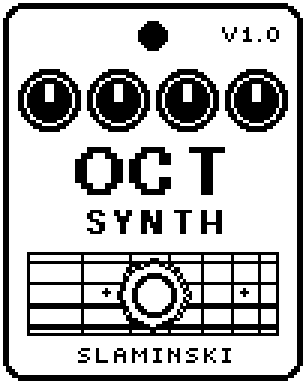

# OctSynth 1.00

An octaver that turns your bass into a synth voice an octave below, with four voice types, a resonant four-pole ladder filter and a clean sub.

- **Version:** 1.00
- **Files:** `OCTSYNTH.ZD2` and `OCTSYNTH.ZIC` (install both)
- **Played by:** your bass
- **On the pedal:** PITCH SHIFT, like every effect of this collection (see [About the files](../README.md#about-the-files))
- **Id:** `07000f62`
- **DSP load:** 27, as declared to the pedal (a patch on the MS-60B+ has room for 270)
- **Delay memory:** none
- **Tested on:** one Zoom MS-60B+, firmware 1.20 only (the same effect code, installed in its own category; see [About the files](../README.md#about-the-files))

## What it does

OctSynth works like an analog octaver: nothing is measured and nothing is waited for. Every cycle of the bass clocks a divider, and the voices are made from that. You get an octave voice in one of four types (OC2, Sqr, Saw, Brass) through a resonant low-pass, a clean sub with its own filter, a voice at the pitch of the bass (Sqr and Saw only) and the dry bass, each with its own level.

## Playing it

- Start with the defaults: the soft OC2 octave under your bass.
- For a synth bass, choose Sqr or Saw, lower Freq, add some Reso, and turn Dry down. Uni adds the same wave at the pitch of the bass.
- For a deep, clean sub under everything, raise Sub. SubFq makes it darker (0.60x) or brighter, with the growl of OC2 (4.00x).
- Play one note at a time, and put OctSynth first in the chain, before any distortion.
- If the voices drop out on soft notes, raise Sens; if noise sets them off, lower it.

## Knobs

| Knob | Range | Default | What it does |
|---|---|---|---|
| `Type` | OC2, Sqr, Saw, Brass | OC2 | Kind of octave voice. OC2: the bass turned over every other cycle, soft. Sqr: square waves. Saw: saws restarted by the bass. Brass: like OC2 with the overtones of the bass, rougher. |
| `Oct` | 0 to 100 | 80 | Level of the octave voice, one octave below the bass. |
| `Sub` | 0 to 100 | 0 | Level of the clean sub, one octave below, whatever Type says. |
| `SubFq` | 0.60x to 4.00x | 1.00x | Low-pass of the sub. It follows the pitch, so it is shown as a multiple of the sub's pitch: low = dark, high = bright. |
| `Uni` | 0 to 100 | 0 | Level of a voice at the pitch of the bass. Sqr and Saw only; it sounds even with Oct at 0. |
| `Freq` | 60 Hz to 8.00k Hz | 929 Hz | Cutoff of the four-pole low-pass (24 dB per octave) on the octave voice and Uni. The sub has its own (SubFq). |
| `Reso` | 0 to 100 | 0 | Resonance of that low-pass, up to a strong peak just short of singing by itself. The low end stays. |
| `Dry` | 0 to 100 | 80 | Level of the bass itself. 80 = as loud as bypassed, 0 = only the voices, 100 = +3.5 dB. |
| `Level` | 0 to 100 | 80 | Level of all voices together, 80 = unity. The dry bass is not affected. |
| `Sens` | 0 to 100 | 50 | How quiet the bass may be and still open the voices. It does not change how loud the voices are. |

## Good to know

- With two notes at once it follows whichever note dominates, like any octaver of this kind.
- At high Reso with Freq low, the filter rings on after a note, up to about a second at the lowest Freq.
- Changing Type while a note sounds can click, mostly between OC2 and Brass with the filter open.
- OctSynth was published earlier in its own repository (up to version 1.04). This version 1.00 is newer: the effects of this collection start their numbering at 1.00 together. It replaces the earlier one: same id (07000f62), same file names; uninstall the old one first. A patch saved with OctSynth 1.01 or older has its knobs in another order: set them again.

## Installing

Read the safety notes in the [collection's README](../README.md#read-this-first) and stomphacks' [SAFETY.md](https://github.com/thammer/stomphacks/blob/main/SAFETY.md) first. Install with [stomphacks](https://github.com/thammer/stomphacks), from its folder, one command at a time, checking each result:

1. `.venv/bin/python3 tools-pedal/safe_connect.py session/` connects and confirms that AUTO SAVE is off.
2. `.venv/bin/python3 tools-pedal/backup_pedal.py backup/` backs up the pedal (once per pedal).
3. `.venv/bin/python3 tools-pedal/pedal_diy.py install <this folder>/OCTSYNTH.ZD2 --dry-run`, then the same without `--dry-run`. It uploads `OCTSYNTH.ZIC` alongside: keep it next to the `.ZD2`, without it pedal_diy.py refuses.
4. `.venv/bin/python3 tools-pedal/readback.py OCTSYNTH.ZD2 session/OCTSYNTH-back.ZD2` and `cmp <this folder>/OCTSYNTH.ZD2 session/OCTSYNTH-back.ZD2`: they must be identical.
5. Try it in an unsaved patch, with the amp or headphones turned down.

To update to a newer version: take the effect out of every patch, `pedal_diy.py uninstall <this folder>/OCTSYNTH.ZD2` (the new file has the old one's name and id), then install the new one as in step 3 and read it back to a new path (for example `session/OCTSYNTH-back2.ZD2`; readback.py does not overwrite a file). The effect appears under PITCH SHIFT on the pedal (see the collection's README).
