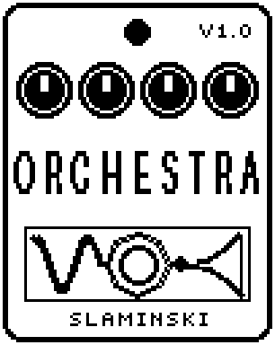

# Orchestra 1.00

Your bass plays a piano, an electric piano, strings or brass on the note you play, alone or as a chord, added to the bass.

- **Version:** 1.00
- **Files:** `ORCHEST.ZD2` and `ORCHEST.ZIC` (install both)
- **Played by:** your bass
- **On the pedal:** PITCH SHIFT, like every effect of this collection (see [About the files](../README.md#about-the-files))
- **Id:** `07000f92`
- **DSP load:** 118, as declared to the pedal (a patch on the MS-60B+ has room for 270)
- **Delay memory:** 3.5 KB
- **Tested on:** one Zoom MS-60B+, firmware 1.20 only (the same effect code, installed in its own category; see [About the files](../README.md#about-the-files))

## What it does

At every pluck Orchestra finds the note of your bass and starts the instrument on it, about 25 to 65 ms after the pluck (on the lowest strings up to 75 ms). A pluck whose pitch is not clear, such as a ghost note, a slap or noise, starts nothing instead of a wrong note. A hammer-on or slide without a new pluck moves the instrument to the new note, without a new attack. It plays one bass note at a time; it is not for chords on the bass. Dry sets how loud the bass itself is next to the instrument.

## Playing it

- Start with the defaults: a piano one octave above your bass (Oct +1), with the bass as it is.
- For pads, choose Strng or Brass and raise Atk for a slower swell; Move adds ensemble and vibrato.
- Chord adds notes to each bass note. Maj and Min put the same kind of chord on every note, so pick the one that fits the line.
- Pluck each note cleanly. If noise or hum starts notes, raise Thr; for a quiet bass, lower it.
- Turn Dry to 0 to hear the instrument alone.

## Knobs

| Knob | Range | Default | What it does |
|---|---|---|---|
| `Voice` | Piano, EPian, Strng, Brass | Piano | Piano: a piano. EPian: an electric piano. Strng: strings that swell in with Atk. Brass: the same, with a filter that opens as the note swells in. |
| `Chord` | Mono, Oct, 5th, Maj, Min | Mono | What plays with the note: Mono = the note alone, Oct = and the octave above, 5th = the fifth and the octave above, Maj or Min = a major or minor third and the fifth. |
| `Oct` | -1, 0, +1, +2 | +1 | Moves everything by octaves from the pitch of the bass. +1 is the usual setting. |
| `Atk` | 0 to 100 | 30 | Strng: how long a note takes to swell in, 3 ms to 2.5 s; Brass a third of that. Piano and EPian: 0 = a hard, bright hammer, 100 = soft and dull. |
| `Dec` | 0 to 100 | 50 | Piano and EPian: how long the note rings while the bass note is held, 0.3 s to 10 s. Not used by Strng and Brass. |
| `Rel` | 0 to 100 | 35 | How fast the sound dies when the bass note is over (string stopped or level fallen), 20 ms to 4 s. |
| `Tone` | 0 to 100 | 55 | Brightness. Strng and Brass: the cutoff of the filter. Piano and EPian: how loud the upper partials are. |
| `Move` | 0 to 100 | 40 | Strng and Brass: the two saws of each note detune against each other, with a vibrato that comes in as the note swells. Piano and EPian: two strings per note that beat slowly. |
| `Dyn` | 0 to 100 | 60 | How much the strength of your pluck sets the loudness of the note. 0 = every note the same, 100 = follows the bass. |
| `Thr` | 0 to 100 | 40 | How loud the bass must be to start a note. |
| `Level` | 0 to 100 | 80 | Level of the instrument. The bass is set by Dry. |
| `Dry` | 0 to 100 | 80 | Level of the bass itself. 80 = as loud as bypassed, 0 = only the instrument, 100 = +3.5 dB. |

## Good to know

- Off (footswitch), the bass passes unchanged, whatever Dry says.
- A note played while the last one still rings almost as loud, or a slide into a note, can start on a wrong note; after a slide Orchestra follows the bass after about 80 ms.
- Orchestra needs 3.5 KB of the pedal's delay memory to find the note. If the pedal has none left for it, your bass passes and no instrument sounds.
- Orchestra needs a lot of the pedal's DSP power (see DSP load above); plan the rest of the chain with that in mind.

## Installing

Read the safety notes in the [collection's README](../README.md#read-this-first) and stomphacks' [SAFETY.md](https://github.com/thammer/stomphacks/blob/main/SAFETY.md) first. Install with [stomphacks](https://github.com/thammer/stomphacks), from its folder, one command at a time, checking each result:

1. `.venv/bin/python3 tools-pedal/safe_connect.py session/` connects and confirms that AUTO SAVE is off.
2. `.venv/bin/python3 tools-pedal/backup_pedal.py backup/` backs up the pedal (once per pedal).
3. `.venv/bin/python3 tools-pedal/pedal_diy.py install <this folder>/ORCHEST.ZD2 --dry-run`, then the same without `--dry-run`. It uploads `ORCHEST.ZIC` alongside: keep it next to the `.ZD2`, without it pedal_diy.py refuses.
4. `.venv/bin/python3 tools-pedal/readback.py ORCHEST.ZD2 session/ORCHEST-back.ZD2` and `cmp <this folder>/ORCHEST.ZD2 session/ORCHEST-back.ZD2`: they must be identical.
5. Try it in an unsaved patch, with the amp or headphones turned down.

To update to a newer version: take the effect out of every patch, `pedal_diy.py uninstall <this folder>/ORCHEST.ZD2` (the new file has the old one's name and id), then install the new one as in step 3 and read it back to a new path (for example `session/ORCHEST-back2.ZD2`; readback.py does not overwrite a file). The effect appears under PITCH SHIFT on the pedal (see the collection's README).
