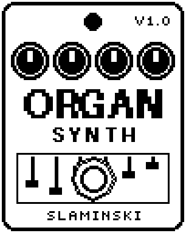

# OrganSynth 1.00

A drawbar organ played by your bass: six drawbars from an octave below to two octaves above, with percussion, a rotary speaker and drive.

- **Version:** 1.00
- **Files:** `ORGSYNTH.ZD2` and `ORGSYNTH.ZIC` (install both)
- **Played by:** your bass
- **On the pedal:** PITCH SHIFT, like every effect of this collection (see [About the files](../README.md#about-the-files))
- **Id:** `07000f86`
- **DSP load:** 60, as declared to the pedal (a patch on the MS-60B+ has room for 270)
- **Delay memory:** none
- **Tested on:** one Zoom MS-60B+, firmware 1.20 only (the same effect code, installed in its own category; see [About the files](../README.md#about-the-files))

## What it does

OrganSynth turns every note you play into a drawbar organ: six pure tones on the pitch of the bass, from one octave below to two octaves above, each with its own level like a drawbar. The organ holds one level as long as the string sounds. Perc adds a short ping to plucked notes, Rotor makes pitch and level sway like a rotary speaker, and Drive takes the organ from clean to a growl. It plays one note at a time, not chords.

## Playing it

- Start with the defaults: Sub, Fund, Oct and 12th with a little percussion and drive, beside your clean bass.
- Add Fifth to Sub for a thick, growling organ. Add 15th for a higher top.
- Set Rotor to FtSw to switch the rotary speaker between Slow and Fast with the footswitch.
- For the organ alone, turn Dry to 0.
- If notes break off early or a quiet bass does not play the organ, raise Sens. Lower it if noise sets the organ off.

## Knobs

| Knob | Range | Default | What it does |
|---|---|---|---|
| `Sub` | 0 to 100 | 60 | Drawbar 16': a pure tone one octave below the bass. |
| `Fund` | 0 to 100 | 80 | Drawbar 8': the note of the bass. |
| `Fifth` | 0 to 100 | 0 | Drawbar 5 1/3': a fifth above the bass. Thick and growling together with Sub. |
| `Oct` | 0 to 100 | 50 | Drawbar 4': one octave above the bass. |
| `12th` | 0 to 100 | 30 | Drawbar 2 2/3': an octave and a fifth above. |
| `15th` | 0 to 100 | 0 | Drawbar 2': two octaves above. |
| `Perc` | 0 to 100 | 30 | Percussion: a short ping one octave above on every plucked note. Notes played legato, without a new pluck, get none. |
| `Rotor` | Off, Slow, Fast, FtSw | Off | Rotary speaker: pitch and level sway. It takes about a second to change speed. FtSw: the footswitch changes between Slow and Fast. |
| `Drive` | 0 to 100 | 20 | Overdrive on the organ, from clean to a growl. The bass itself stays clean. |
| `Dry` | 0 to 100 | 80 | Level of your bass. 80 = unchanged, as loud as bypassed; 0 = only the organ. |
| `Level` | 0 to 100 | 80 | Level of the organ, 80 = unity. The bass is not affected. |
| `Sens` | 0 to 100 | 50 | Input sensitivity: how quietly you can play and still hold the organ. |

## Good to know

- With Rotor on FtSw, every press of the footswitch changes between Slow and Fast, whatever the LED shows, and the effect is never bypassed. It starts Slow, also after loading a patch.
- Turning Rotor away from FtSw and back, without loading the patch again, carries on at the speed it had (for example Fast).
- The organ speaks at the first cycle after a pluck and finds its exact pitch within the next two.
- Runs on the pedal together with FMSynth, a compressor, a delay and a reverb in one patch.

## Installing

Read the safety notes in the [collection's README](../README.md#read-this-first) and stomphacks' [SAFETY.md](https://github.com/thammer/stomphacks/blob/main/SAFETY.md) first. Install with [stomphacks](https://github.com/thammer/stomphacks), from its folder, one command at a time, checking each result:

1. `.venv/bin/python3 tools-pedal/safe_connect.py session/` connects and confirms that AUTO SAVE is off.
2. `.venv/bin/python3 tools-pedal/backup_pedal.py backup/` backs up the pedal (once per pedal).
3. `.venv/bin/python3 tools-pedal/pedal_diy.py install <this folder>/ORGSYNTH.ZD2 --dry-run`, then the same without `--dry-run`. It uploads `ORGSYNTH.ZIC` alongside: keep it next to the `.ZD2`, without it pedal_diy.py refuses.
4. `.venv/bin/python3 tools-pedal/readback.py ORGSYNTH.ZD2 session/ORGSYNTH-back.ZD2` and `cmp <this folder>/ORGSYNTH.ZD2 session/ORGSYNTH-back.ZD2`: they must be identical.
5. Try it in an unsaved patch, with the amp or headphones turned down.

To update to a newer version: take the effect out of every patch, `pedal_diy.py uninstall <this folder>/ORGSYNTH.ZD2` (the new file has the old one's name and id), then install the new one as in step 3 and read it back to a new path (for example `session/ORGSYNTH-back2.ZD2`; readback.py does not overwrite a file). The effect appears under PITCH SHIFT on the pedal (see the collection's README).
