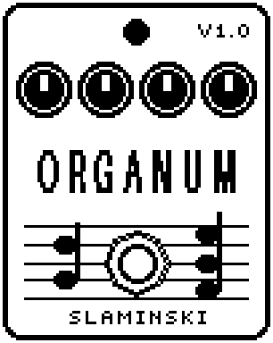

# Organum 1.00

Six octave and fifth voices, from an octave below to three octaves above, made from your bass itself (chords work too), with a swell or decay envelope and a resonant filter.

- **Version:** 1.00
- **Files:** `ORGANUM.ZD2` and `ORGANUM.ZIC` (install both)
- **Played by:** your bass
- **On the pedal:** PITCH SHIFT, like every effect of this collection (see [About the files](../README.md#about-the-files))
- **Id:** `07000f83`
- **DSP load:** 80, as declared to the pedal (a patch on the MS-60B+ has room for 270)
- **Delay memory:** 16 KB
- **Tested on:** one Zoom MS-60B+, firmware 1.20 only (the same effect code, installed in its own category; see [About the files](../README.md#about-the-files))

## What it does

Organum mixes the bass (Root) with voices an octave below, a fifth above, and one, one and a half, two and three octaves above, each with its own level. The voices are your bass itself, read faster or slower from memory, so chords work too; they come 20 to 40 ms after the bass. One envelope (Env) makes all voices and the bass swell in or die away. A resonant low-pass sits behind everything, and Level sets the whole output.

## Playing it

- Start with the defaults: the bass, the octave above and a little of two octaves above.
- Mix the voices to taste. Tone low gives round, flute-like voices, nearly sines; Tone high uses all of the string, brighter and thinner.
- For swells, turn Env below 0: -25 swells in over 40 ms, -50 over 1.5 s. From -15 down every new note swells in.
- For notes that die away while the string still sounds, turn Env above 0: +25 = 0.45 s, +50 = 25 ms.
- Turn Root to 0 to hear the voices alone. For a resonant filter sound, lower Freq and add Reso.

## Knobs

| Knob | Range | Default | What it does |
|---|---|---|---|
| `-1Oct` | 0 to 100 | 0 | Level of the voice an octave below. |
| `Root` | 0 to 100 | 100 | Level of the bass itself. It goes with Env, through the filter and with Level. 0 = the voices alone. |
| `5th` | 0 to 100 | 0 | Level of the voice a fifth above. |
| `Oct` | 0 to 100 | 80 | Level of the voice an octave above. |
| `Oct5` | 0 to 100 | 0 | Level of the voice an octave and a fifth above. |
| `2Oct` | 0 to 100 | 35 | Level of the voice two octaves above. |
| `3Oct` | 0 to 100 | 0 | Level of the voice three octaves above. |
| `Tone` | 150 Hz to 2.60k Hz | 720 Hz | A low-pass in front of the voices: how much of the string they are made of. Low = round, nearly sines; high = brighter. |
| `Freq` | 50 Hz to 12.0k Hz | 12.0k Hz | Cutoff of the resonant low-pass behind everything, Root too. 12.0k with Reso 0 = no filter. |
| `Reso` | 0 to 100 | 0 | Resonance of that low-pass: 0 = no peak, 100 = a strong peak at Freq. |
| `Env` | -50 to +50 | 0 | Envelope of all voices and Root. 0 = off. Below 0 notes swell in (-1 = 1 ms, -50 = 1.5 s); above 0 every note dies away (+1 = 7 s, +50 = 25 ms). |
| `Level` | 0 to 100 | 80 | Output level of the bass and the voices while the effect is on. 80 = unity, 100 = +3.5 dB, 0 = silent. |

## Good to know

- The voice knobs are not linear: 50 gives a quarter of the level of 100.
- From Env -1 to -14 only a note out of silence swells in; a note played while the last one still sounds starts at full level.
- When Organum starts again while a note sounds (inserted, patch loaded, chain changed, or after the tuner), the voices above the bass fade in softly after about 80 ms.
- Organum needs 16 KB of the pedal's delay memory. If the pedal has none left for it, your bass passes and there are no voices.

## Installing

Read the safety notes in the [collection's README](../README.md#read-this-first) and stomphacks' [SAFETY.md](https://github.com/thammer/stomphacks/blob/main/SAFETY.md) first. Install with [stomphacks](https://github.com/thammer/stomphacks), from its folder, one command at a time, checking each result:

1. `.venv/bin/python3 tools-pedal/safe_connect.py session/` connects and confirms that AUTO SAVE is off.
2. `.venv/bin/python3 tools-pedal/backup_pedal.py backup/` backs up the pedal (once per pedal).
3. `.venv/bin/python3 tools-pedal/pedal_diy.py install <this folder>/ORGANUM.ZD2 --dry-run`, then the same without `--dry-run`. It uploads `ORGANUM.ZIC` alongside: keep it next to the `.ZD2`, without it pedal_diy.py refuses.
4. `.venv/bin/python3 tools-pedal/readback.py ORGANUM.ZD2 session/ORGANUM-back.ZD2` and `cmp <this folder>/ORGANUM.ZD2 session/ORGANUM-back.ZD2`: they must be identical.
5. Try it in an unsaved patch, with the amp or headphones turned down.

To update to a newer version: take the effect out of every patch, `pedal_diy.py uninstall <this folder>/ORGANUM.ZD2` (the new file has the old one's name and id), then install the new one as in step 3 and read it back to a new path (for example `session/ORGANUM-back2.ZD2`; readback.py does not overwrite a file). The effect appears under PITCH SHIFT on the pedal (see the collection's README).
