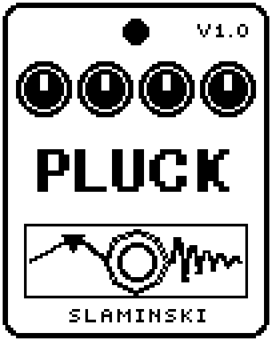

# Pluck 1.00

A plucked-string synth: every pluck of your bass, or every key of a MIDI keyboard through the MS Plus Bridge, plucks a string tuned to that note.

- **Version:** 1.00
- **Files:** `PLUCK.ZD2` and `PLUCK.ZIC` (install both)
- **Played by:** your bass, or a MIDI keyboard through the [MS Plus Bridge](https://github.com/skislaminski/MS-Plus-Bridge)
- **On the pedal:** PITCH SHIFT, like every effect of this collection (see [About the files](../README.md#about-the-files))
- **Id:** `07000f8f`
- **DSP load:** 117, as declared to the pedal (a patch on the MS-60B+ has room for 270)
- **Delay memory:** 19.5 KB
- **Tested on:** one Zoom MS-60B+, firmware 1.20 only (the same effect code, installed in its own category; see [About the files](../README.md#about-the-files))

## What it does

Pluck makes a string the classic way (Karplus-Strong): a short burst of noise runs round a loop one period of the note long and loses a little of its highs every round, as a plucked string does. Two strings take the notes in turn, so the old note rings on under the new one. With Trig on Bass, Pluck finds the note of each pluck and the string sounds about 25 to 65 ms later (on the lowest strings up to 75 ms); a pluck whose pitch is not clear plucks nothing. With Trig on Key, the string sounds at once. Dry sets how loud the bass itself is next to the strings.

## Playing it

- Start with the defaults: a string on the note you play, next to your bass.
- Pick sets the kind of string: Noise for a guitar or harp, Soft for a darker finger-on-nylon sound, Pulse for a pure, singing string.
- Tone sets how hard the pluck is, Decay how long the string rings. Oct puts the string an octave below or above.
- Pluck each note cleanly, one note at a time. If noise or hum plucks strings, raise Thr; for a quiet bass, lower it.
- To play it from keys, connect a MIDI keyboard through the MS Plus Bridge. If Trig is on Bass, the bridge sets it to Key with your first note; save the patch to keep that.

## Knobs

| Knob | Range | Default | What it does |
|---|---|---|---|
| `Key` | 0 to 1000 | 0 | Gate and pitch, written by the MS Plus Bridge: 0 = off, every step 10 cents above C0. With Trig on Key every new note plucks a string, tuned to that note. |
| `Level` | 0 to 100 | 80 | Level of the strings. The bass is set by Dry. |
| `Trig` | Key, Bass | Bass | What plucks a string. Key: every new note on the Key knob. Bass: every pluck of the bass louder than Thr. |
| `Decay` | 0 to 100 | 55 | How long a string rings until it is 60 dB down, 0.1 s to 12 s. Very high notes die faster. |
| `Tone` | 0 to 100 | 60 | How bright the pluck is: 0 = dark and soft, 100 = white noise, hard. |
| `Pick` | Noise, Soft, Pulse | Noise | What starts the string. Noise: a burst of noise. Soft: the same, darker. Pulse: a single click, a pure, singing string. |
| `Oct` | -1, 0, +1 | 0 | The string an octave below, on, or an octave above the note. Notes below C1 or above E6 stay there. |
| `Dyn` | 0 to 100 | 60 | Trig Bass: how much the strength of your pluck sets the loudness of the string. 0 = every pluck the same, 100 = follows the bass. |
| `Thr` | 0 to 100 | 40 | Trig Bass: how loud the bass must be to pluck a string. |
| `Dry` | 0 to 100 | 80 | Level of the bass itself. 80 = as it is, 0 = only the strings, 100 = +3.5 dB. Off (footswitch), the bass passes unchanged. |

## Good to know

- A string keeps the pitch it was plucked with: the pitch wheel does not bend it, and after a slide into a note it plays the note the slide started on.
- Letting go of a key does not stop the string; it rings out with Decay.
- Pluck needs 19.5 KB of the pedal's delay memory. If the pedal has none left for it, your bass passes and no string sounds.
- If you replace Pluck in a patch with a delay effect in the same place, that delay can play a short, loud leftover of the strings once.
- Pluck needs a lot of the pedal's DSP power (see DSP load above); plan the rest of the chain with that in mind.

## Installing

Read the safety notes in the [collection's README](../README.md#read-this-first) and stomphacks' [SAFETY.md](https://github.com/thammer/stomphacks/blob/main/SAFETY.md) first. Install with [stomphacks](https://github.com/thammer/stomphacks), from its folder, one command at a time, checking each result:

1. `.venv/bin/python3 tools-pedal/safe_connect.py session/` connects and confirms that AUTO SAVE is off.
2. `.venv/bin/python3 tools-pedal/backup_pedal.py backup/` backs up the pedal (once per pedal).
3. `.venv/bin/python3 tools-pedal/pedal_diy.py install <this folder>/PLUCK.ZD2 --dry-run`, then the same without `--dry-run`. It uploads `PLUCK.ZIC` alongside: keep it next to the `.ZD2`, without it pedal_diy.py refuses.
4. `.venv/bin/python3 tools-pedal/readback.py PLUCK.ZD2 session/PLUCK-back.ZD2` and `cmp <this folder>/PLUCK.ZD2 session/PLUCK-back.ZD2`: they must be identical.
5. Try it in an unsaved patch, with the amp or headphones turned down.

To update to a newer version: take the effect out of every patch, `pedal_diy.py uninstall <this folder>/PLUCK.ZD2` (the new file has the old one's name and id), then install the new one as in step 3 and read it back to a new path (for example `session/PLUCK-back2.ZD2`; readback.py does not overwrite a file). The effect appears under PITCH SHIFT on the pedal (see the collection's README).
