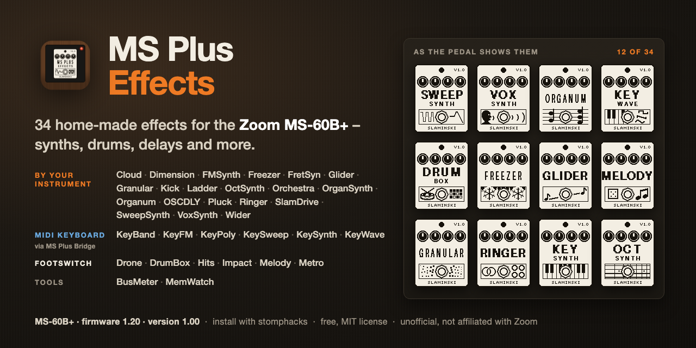

# MS Plus Effects

Home-made effects for the Zoom MS-60B+ bass pedal: 34 effects, most of them played by your instrument itself, some from a MIDI keyboard through the [MS Plus Bridge](https://github.com/skislaminski/MS-Plus-Bridge). Each folder holds the two files to install, a short guide (`README.md`) and the picture the pedal shows. KeyWave's folder also holds the app KeyWave Tables.

## Read this first

> **These are unofficial effects, not made, tested or supported by Zoom.** A custom effect runs inside your pedal. A faulty effect in a saved patch, or a file transfer that is interrupted, can leave the pedal unable to start, and there is no dependable way back.
>
> - **MS-60B+ only.** The code of every effect here has been played on one MS-60B+ with firmware 1.20 (see [About the files](#about-the-files)). None has been tried on the MS-50G+, the MS-70CDR+, any other model or any other firmware. Do not put them on another model.
> - Install with [stomphacks](https://github.com/thammer/stomphacks) and read its [SAFETY.md](https://github.com/thammer/stomphacks/blob/main/SAFETY.md) completely before you connect anything.
> - Back up your pedal before you install anything, and keep AUTO SAVE off.
> - Try every new effect in an unsaved patch, with the amp or headphones turned down: some are louder than the bass at their defaults or can sing on their own.
> - stomphacks' SAFETY.md says never to save a patch that contains an experimental effect: play them in the current, unsaved patch. Saving one is at your own risk; if you do, first try the effect there (insert it, turn every knob, switch it on and off, change the chain), and before you switch the pedal off, select a patch with only Zoom effects.
> - If a transfer hangs or fails: do not switch the pedal off. Keep it powered and follow SAFETY.md.
> - If the pedal goes silent: do not save; switch it off and on.

## What you need

- a Zoom MS-60B+ with firmware 1.20
- [stomphacks](https://github.com/thammer/stomphacks) by Thomas Hammer, whose pedal tools install the effects. Set it up as its README says under "Getting started", the Python part only: Python 3 with its `.venv` (`pip install -r requirements.txt`) and a clone of [zoom-zt2](https://github.com/mungewell/zoom-zt2) at `zoom-zt2/` inside it. The TI compiler is not needed; the effects here are built. On Windows use `.venv\Scripts\python.exe` in place of `.venv/bin/python3`, and `fc /b` in place of `cmp`.
- for the keyboard effects: a MIDI keyboard and the [MS Plus Bridge](https://github.com/skislaminski/MS-Plus-Bridge)
- to make your own KeyWave wavetables: the app KeyWave Tables, for Mac and Windows, in the folder [KeyWave](KeyWave/README.md)

## About the files

Every `.ZD2` here carries the header of an MS-60B+ effect in the category PITCH SHIFT and an id on stomphacks' DIY page (07000F00 to 07000FFF), because that is what stomphacks' installer accepts. So on the pedal all of them appear under PITCH SHIFT, whatever kind of effect they are. The effect code is byte for byte the code that runs on the author's MS-60B+, where the same effects sit in their own categories (installed with another tool). Installing with stomphacks was proven on the MS-60B+ with KeySynth in October 2026; not every file here has been installed that way.

## Played by your instrument

| Effect | Version | What it is |
|---|---|---|
| [Cloud](Cloud/README.md) | 1.00 | A granular cloud that replays your bass as overlapping grains, each at a pitch and a stereo place picked by chance, with the pitches kept in a scale if you like. |
| [Dimension](Dimension/README.md) | 1.00 | A stereo chorus for bass with five modes that adds a slowly moving copy to your bass and never thins out the low end. |
| [FMSynth](FMSynth/README.md) | 1.00 | An FM synth voice played by your bass, from a pure sine to hollow, bright, bell-like and gritty tones, with every note starting bright and settling. |
| [Freezer](Freezer/README.md) | 1.00 | A freeze that holds the note you are playing when you press the footswitch, as a steady loop you can play over. |
| [FretSyn](FretSyn/README.md) | 1.00 | A two-oscillator synth that plays the note of your bass, through a resonant four-pole low-pass filter that opens with every pluck. |
| [Glider](Glider/README.md) | 1.00 | A freeze with glide: every press of the footswitch holds the note you play, and the held sound slides from the old note to the new one. |
| [Granular](Granular/README.md) | 1.00 | A granular delay that replays the last third of a second of your bass as up to four overlapping grains, each from its own place, forwards or backwards, at a pitch you choose. |
| [Kick](Kick/README.md) | 1.00 | An analog-style bass drum and tom, hit by every pluck of your bass; the bass passes unchanged and the drum is added. |
| [Ladder](Ladder/README.md) | 1.00 | A four-pole analog-style low-pass filter for bass, with resonance up to self-oscillation, an envelope that opens it as you dig in, and an LFO. |
| [OctSynth](OctSynth/README.md) | 1.00 | An octaver that turns your bass into a synth voice an octave below, with four voice types, a resonant four-pole ladder filter and a clean sub. |
| [Orchestra](Orchestra/README.md) | 1.00 | Your bass plays a piano, an electric piano, strings or brass on the note you play, alone or as a chord, added to the bass. |
| [OrganSynth](OrganSynth/README.md) | 1.00 | A drawbar organ played by your bass: six drawbars from an octave below to two octaves above, with percussion, a rotary speaker and drive. |
| [Organum](Organum/README.md) | 1.00 | Six octave and fifth voices, from an octave below to three octaves above, made from your bass itself (chords work too), with a swell or decay envelope and a resonant filter. |
| [OSCDLY](OSCDLY/README.md) | 1.00 | A short delay whose feedback goes past 100 %, so the repeats build up and sing by themselves, held in check by a limiter and darkened by a low-pass in the loop. |
| [Pluck](Pluck/README.md) | 1.00 | A plucked-string synth: every pluck of your bass, or every key of a MIDI keyboard through the MS Plus Bridge, plucks a string tuned to that note. |
| [Ringer](Ringer/README.md) | 1.00 | A ring modulator for bass that multiplies your notes with a carrier wave, from slow tremolo and wobble to rough, detuned tones, bells and metal, with an LFO that sweeps the carrier. |
| [SlamDrive](SlamDrive/README.md) | 1.00 | A two-band bass drive that keeps the low end clean and pressed flat by a hard compressor while the part above it is distorted, each band with its own compressor, EQ and level. |
| [SweepSynth](SweepSynth/README.md) | 1.00 | An analog-style synth made from your bass itself, no keyboard needed: square waves on and below your note and a fuzzy octave above, through a resonant filter that sweeps at every note. |
| [VoxSynth](VoxSynth/README.md) | 1.00 | A singing voice played by your bass that says vowels and moves from one vowel to another at every note. |
| [Wider](Wider/README.md) | 1.00 | A stereo chorus and vibrato for bass that leaves everything below a split frequency dry, so the low end stays solid even at full vibrato. |

## Played from a MIDI keyboard

| Effect | Version | What it is |
|---|---|---|
| [KeyBand](KeyBand/README.md) | 1.00 | A piano, electric piano, strings or brass for up to four notes at once, played from a MIDI keyboard. |
| [KeyFM](KeyFM/README.md) | 1.00 | An FM mono synth played from a MIDI keyboard: one sine modulates another, from a pure sine to bright, bell-like and metallic tones. |
| [KeyPoly](KeyPoly/README.md) | 1.00 | A four-voice synth for chords, played from a MIDI keyboard, with a shared resonant low-pass filter and an LFO. |
| [KeySweep](KeySweep/README.md) | 1.00 | A mono synth played from a MIDI keyboard, through a resonant 24 dB low-pass filter with its own envelope. |
| [KeySynth](KeySynth/README.md) | 1.00 | A two-oscillator mono synth played from a MIDI keyboard, with glide and an LFO for vibrato or tremolo. |
| [KeyWave](KeyWave/README.md) | 1.00 | A wavetable mono synth played from a MIDI keyboard, morphing between eight waveforms (from saw to square in the table it comes with). |

## Started with the footswitch

| Effect | Version | What it is |
|---|---|---|
| [Drone](Drone/README.md) | 1.00 | A drone machine that fades in a held three-voice chord on the note you played last, on a note that follows your bass, or on a fixed note. |
| [DrumBox](DrumBox/README.md) | 1.00 | A drum computer with kick, snare, hi-hat, cymbals and toms: 17 patterns with fills, in the tempo of the patch or at its own, added to your bass. |
| [Hits](Hits/README.md) | 1.00 | A little sampler for the footswitch with eight one-shot sounds (orchestra hit, choir, gong, bell, clap, snare, tom and synth stab), added to your bass. |
| [Impact](Impact/README.md) | 1.00 | Sound effects for the footswitch, added to your bass: a sub kick (808), a falling Drop, a Boom, a Riser, a Laser, a Siren and an Alarm. |
| [Melody](Melody/README.md) | 1.00 | A generative melody player that plays random notes in a scale and key you choose, or in the key of the note you played last, in the tempo of the patch or at its own. |
| [Metro](Metro/README.md) | 1.00 | A metronome with an accent on the first click of the bar, in the tempo of the patch or at its own, with a practice mode that mutes bars. |

## Measuring tools (not needed for playing)

| Effect | Version | What it is |
|---|---|---|
| [BusMeter](BusMeter/README.md) | 1.00 | A measuring tool that shows how loud the signal is at its place in the chain, and from which level the pedal starts to distort. |
| [MemWatch](MemWatch/README.md) | 1.00 | A measuring tool that watches its delay memory and tells you by sound whether another effect writes into it, and how much delay memory the pedal offers. |

## License and credits

- MIT, see [LICENSE](LICENSE). Copyright Lukas Kaminski: the effects, their tables, pictures and guides, and the app KeyWave Tables. Copyright Thomas Hammer: the kernel skeleton every effect starts from (stomphacks `effects/gain/gain.c`) and the scaffold [stomphacks](https://github.com/thammer/stomphacks) generates around each kernel, which is part of every `.ZD2` file.
- The effects that use delay memory handle it in the way [nam-to-zoom](https://github.com/digcha-ka/nam-to-zoom) by Aleksandar Vukasinovic (MIT) showed.
- KeySynth's set of features follows SYNTHESIS SYNx2 by Leemuzhko (see its guide).
- The two app zips in the folder KeyWave contain third-party software under its own licences; the licence files are inside each zip.
- The source code of the effects is not part of this repository.
- Zoom and MS-60B+ are trademarks of Zoom Corporation. Other product names are used only to describe a sound.
