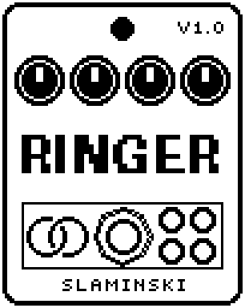

# Ringer 1.00

A ring modulator for bass that multiplies your notes with a carrier wave, from slow tremolo and wobble to rough, detuned tones, bells and metal, with an LFO that sweeps the carrier.

- **Version:** 1.00
- **Files:** `RINGER.ZD2` and `RINGER.ZIC` (install both)
- **Played by:** your bass
- **On the pedal:** PITCH SHIFT, like every effect of this collection (see [About the files](../README.md#about-the-files))
- **Id:** `07000f79`
- **DSP load:** 31, as declared to the pedal (a patch on the MS-60B+ has room for 270)
- **Delay memory:** none
- **Tested on:** one Zoom MS-60B+, firmware 1.20 only (the same effect code, installed in its own category; see [About the files](../README.md#about-the-files))

## What it does

Ringer multiplies your bass with a carrier wave. That adds new tones on both sides of every overtone of your bass, which gives the metallic, detuned sound. In Range Lo the carrier is slow (0.6 Hz to 80 Hz) and gives tremolo, wobble and growl; in Range Hi (30 Hz to 4 kHz) it is the classic ring modulator, from rough and detuned to bells and metal. An LFO sweeps the carrier frequency for vibrato, sirens, trills or random jumps. The first seven knobs are those of a classic analog ring modulator; Wave, Ring and Level are extras.

## Playing it

- Start with the defaults: Range Hi, the carrier at 246 Hz, bass and ring modulator mixed evenly, and a light vibrato on the carrier.
- Keep Mix below 100 for a solid low end: at 100 the fundamental of your notes is gone.
- For tremolo or wobble, set Range to Lo. There the carrier is the Freq label divided by 50, so 246 is about 5 Hz.
- With Amnt turned up, LWave Sine gives a siren and Sqr a trill between two carrier frequencies.

## Knobs

| Knob | Range | Default | What it does |
|---|---|---|---|
| `Drive` | 0 to 100 | 0 | How hard the bass hits the ring modulator. Turned up it saturates: more overtones and a steadier level. Only the effect's share is driven, the dry bass stays clean. |
| `Freq` | 30.0 Hz to 4.00k Hz | 246 Hz | Carrier frequency. The labels show Range Hi; in Range Lo the carrier is the label divided by 50 (0.6 Hz to 80 Hz). |
| `Range` | Lo, Hi | Hi | Lo: 0.6 Hz to 80 Hz, from slow tremolo to growl. Hi: 30 Hz to 4 kHz, from rough and detuned to bells and metal. |
| `Mix` | 0 to 100 | 50 | 0 = the bass alone, 100 = the ring modulator alone. The loudness stays about level on the way. |
| `Amnt` | 0 to 100 | 20 | How far the LFO sweeps the carrier: 100 = 1.5 octaves up and down from Freq, 20 = a vibrato. 0 = off. |
| `Rate` | 0.10 Hz to 25.0 Hz | 6.29 Hz | Speed of the LFO. |
| `LWave` | Sine, Sqr, Tri, Rnd | Sine | Shape of the LFO. Sine: vibrato and siren. Sqr: a trill between two carrier frequencies. Tri: a triangle. Rnd: a new random value once per cycle. |
| `Wave` | Sine, Tri, Sqr | Sine | Shape of the carrier. Tri and Sqr add more sidebands. At Mix 100, Sqr is about 3 dB louder than Sine, Tri up to 2 dB quieter. |
| `Ring` | Mult, Diode | Mult | Mult: a clean multiplier. Diode: like a diode ring, which clips the carrier and reacts to how hard you play. |
| `Level` | 0 to 100 | 80 | Output level while the effect is on. 80 = as loud as it comes in. |

## Good to know

- Drive changes the level: a softly played bass gets louder (up to about 7 dB at Drive 100), a bass played hard gets a little quieter. Set Level to match.

## Installing

Read the safety notes in the [collection's README](../README.md#read-this-first) and stomphacks' [SAFETY.md](https://github.com/thammer/stomphacks/blob/main/SAFETY.md) first. Install with [stomphacks](https://github.com/thammer/stomphacks), from its folder, one command at a time, checking each result:

1. `.venv/bin/python3 tools-pedal/safe_connect.py session/` connects and confirms that AUTO SAVE is off.
2. `.venv/bin/python3 tools-pedal/backup_pedal.py backup/` backs up the pedal (once per pedal).
3. `.venv/bin/python3 tools-pedal/pedal_diy.py install <this folder>/RINGER.ZD2 --dry-run`, then the same without `--dry-run`. It uploads `RINGER.ZIC` alongside: keep it next to the `.ZD2`, without it pedal_diy.py refuses.
4. `.venv/bin/python3 tools-pedal/readback.py RINGER.ZD2 session/RINGER-back.ZD2` and `cmp <this folder>/RINGER.ZD2 session/RINGER-back.ZD2`: they must be identical.
5. Try it in an unsaved patch, with the amp or headphones turned down.

To update to a newer version: take the effect out of every patch, `pedal_diy.py uninstall <this folder>/RINGER.ZD2` (the new file has the old one's name and id), then install the new one as in step 3 and read it back to a new path (for example `session/RINGER-back2.ZD2`; readback.py does not overwrite a file). The effect appears under PITCH SHIFT on the pedal (see the collection's README).
