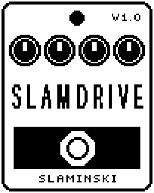

# SlamDrive 1.00

A two-band bass drive that keeps the low end clean and pressed flat by a hard compressor while the part above it is distorted, each band with its own compressor, EQ and level.

- **Version:** 1.00
- **Files:** `SLAMDRV.ZD2` and `SLAMDRV.ZIC` (install both)
- **Played by:** your bass
- **On the pedal:** PITCH SHIFT, like every effect of this collection (see [About the files](../README.md#about-the-files))
- **Id:** `07000f70`
- **DSP load:** 55, as declared to the pedal (a patch on the MS-60B+ has room for 270)
- **Delay memory:** none
- **Tested on:** one Zoom MS-60B+, firmware 1.20 only (the same effect code, installed in its own category; see [About the files](../README.md#about-the-files))

## What it does

SlamDrive splits your bass at XFreq (40 Hz to 300 Hz). Below it the bass stays clean: a hard, fast compressor (CmpLo) presses it flat, attack included, and Deep and Bass shape it. Above it the bass goes into a clipper (Drive, Shape), a compressor of its own (CmpHi) and an EQ (Mid, MidF, High). Each band has its own level at the end; there is no overall level knob.

## Playing it

- Start with the defaults: a clean, compressed low end below 125 Hz and a distorted band above it.
- Set the balance of clean and dirty with LvlLo and LvlHi. A higher XFreq keeps more of the bass clean, a lower one distorts more of it.
- Turn CmpLo up for a low end that does not move. A normally played note stays as loud, so you do not have to correct the level.
- Shape the distortion with Mid and MidF (low: body and growl, high: bite and clank), and take the fizz off with High.

## Knobs

| Knob | Range | Default | What it does |
|---|---|---|---|
| `CmpLo` | 0 to 100 | 40 | Hard, fast compressor on the clean band; it presses the low end flat. A normally played note stays as loud. 0 = off. |
| `Deep` | 0 to 100 | 50 | EQ of the clean band below 80 Hz, -12 dB to +12 dB, 50 = flat. Down tightens the low end, up makes it fatter. |
| `Bass` | 0 to 100 | 50 | EQ of the clean band, a bell at 150 Hz, -12 dB to +12 dB, 50 = flat. |
| `XFreq` | 40 Hz to 300 Hz | 125 Hz | Crossover, in steps of 5 Hz. Below it the bass stays clean, above it it is distorted. |
| `CmpHi` | 0 to 100 | 0 | The same compressor on the distorted band, behind the clipper. At low Drive it evens the band out; at high Drive the clipper does most of that already. 0 = off. |
| `Drive` | 0 to 100 | 55 | Gain into the clipper, +3.5 dB to +50 dB. The level behind it is taken back with it. |
| `Shape` | 0 to 100 | 30 | 0 = soft and symmetric clipping, 100 = hard and lopsided: rougher, with even harmonics at moderate Drive. |
| `Mid` | 0 to 100 | 50 | EQ of the distorted band, a bell at MidF, -12 dB to +12 dB, 50 = flat. Raising it makes the band louder: take LvlHi back. |
| `MidF` | 200 Hz to 3.00k Hz | 677 Hz | Where the Mid bell sits. Low: body and growl. High: bite and clank. Does nothing while Mid is at 50. |
| `High` | 0 to 100 | 50 | EQ of the distorted band, a shelf from 2.5 kHz up, -12 dB to +12 dB, 50 = flat. Up brings out the attack, down takes the fizz off. |
| `LvlLo` | 0 to 100 | 80 | Level of the clean band. 80 = as loud as it comes in, with or without CmpLo. |
| `LvlHi` | 0 to 100 | 70 | Level of the distorted band. 80 = as loud as it comes out of the clipper. |

## Good to know

- The compressors are set for a note of normal strength. If you play much harder or softer than that, the band comes out up to about 5 dB softer or louder at high CmpLo or CmpHi than at 0.
- In pauses the compressors add no gain, so noise and hum stay as they are at 0. Very soft notes (more than about 23 dB under a normal one) get their gain over 25 to 50 ms, so they swell in a little.

## Installing

Read the safety notes in the [collection's README](../README.md#read-this-first) and stomphacks' [SAFETY.md](https://github.com/thammer/stomphacks/blob/main/SAFETY.md) first. Install with [stomphacks](https://github.com/thammer/stomphacks), from its folder, one command at a time, checking each result:

1. `.venv/bin/python3 tools-pedal/safe_connect.py session/` connects and confirms that AUTO SAVE is off.
2. `.venv/bin/python3 tools-pedal/backup_pedal.py backup/` backs up the pedal (once per pedal).
3. `.venv/bin/python3 tools-pedal/pedal_diy.py install <this folder>/SLAMDRV.ZD2 --dry-run`, then the same without `--dry-run`. It uploads `SLAMDRV.ZIC` alongside: keep it next to the `.ZD2`, without it pedal_diy.py refuses.
4. `.venv/bin/python3 tools-pedal/readback.py SLAMDRV.ZD2 session/SLAMDRV-back.ZD2` and `cmp <this folder>/SLAMDRV.ZD2 session/SLAMDRV-back.ZD2`: they must be identical.
5. Try it in an unsaved patch, with the amp or headphones turned down.

To update to a newer version: take the effect out of every patch, `pedal_diy.py uninstall <this folder>/SLAMDRV.ZD2` (the new file has the old one's name and id), then install the new one as in step 3 and read it back to a new path (for example `session/SLAMDRV-back2.ZD2`; readback.py does not overwrite a file). The effect appears under PITCH SHIFT on the pedal (see the collection's README).
