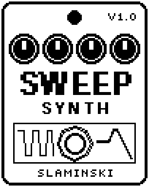

# SweepSynth 1.00

An analog-style synth made from your bass itself, no keyboard needed: square waves on and below your note and a fuzzy octave above, through a resonant filter that sweeps at every note.

- **Version:** 1.00
- **Files:** `FILTSYN.ZD2` and `FILTSYN.ZIC` (install both)
- **Played by:** your bass
- **On the pedal:** PITCH SHIFT, like every effect of this collection (see [About the files](../README.md#about-the-files))
- **Id:** `07000f74`
- **DSP load:** 60, as declared to the pedal (a patch on the MS-60B+ has room for 270)
- **Delay memory:** none
- **Tested on:** one Zoom MS-60B+, firmware 1.20 only (the same effect code, installed in its own category; see [About the files](../README.md#about-the-files))

## What it does

SweepSynth turns your bass into three synth voices: a square wave at the pitch of the bass (Sqr), a square one octave below (Sub), and the octave above (Oct), which is the bass rectified, fuzzy and with the dynamics of your playing. All three run through a resonant filter that moves from Start to Stop at every note, at the speed of Rate. How hard you play sets how loud the voices are, and your clean bass stays beside them (Dry). KeySweep is the same idea, played from a keyboard.

## Playing it

- Start with the defaults: square and sub through a filter that opens from 163 Hz to 1.42k Hz at every note.
- Set Stop above Start for a filter that opens with every note, or below Start for one that closes.
- Rate sets how long the sweep takes: from 4 s at 0 for slow swells to 15 ms at 100 for a quick blip. Reso makes the sweep stand out more.
- For the synth alone, turn Dry to 0. The level of the synth is set with Sqr, Sub and Oct; there is no Level knob.
- If quiet notes do not open the voices, raise Trig. For a bowed attack, raise Atk.

## Knobs

| Knob | Range | Default | What it does |
|---|---|---|---|
| `Sqr` | 0 to 100 | 70 | Level of the square wave at the pitch of the bass. |
| `Sub` | 0 to 100 | 60 | Level of the square wave one octave below. |
| `Oct` | 0 to 100 | 0 | Level of the octave above: the bass rectified, fuzzy and following your dynamics. |
| `Dry` | 0 to 100 | 100 | Level of your bass beside the synth. 100 = unchanged, 0 = only the synth. |
| `Start` | 55 Hz to 4.19k Hz | 163 Hz | Cutoff of the filter when a note begins. |
| `Stop` | 55 Hz to 4.19k Hz | 1.42k Hz | Cutoff the filter moves to. Above Start it opens with every note, below Start it closes. |
| `Rate` | 0 to 100 | 55 | How fast the filter goes from Start to Stop: 4 s at 0, 15 ms at 100. |
| `Reso` | 0 to 100 | 55 | Resonance of the filter. |
| `Trig` | 0 to 100 | 50 | Sensitivity: how quietly you can play and still open the voices and start the filter. |
| `Atk` | 0 to 100 | 10 | How slowly the voices come in after the pluck, 1 ms to 1 s, for a bowed attack. |

## Good to know

- Watch the level: with the defaults (Dry 100 plus the synth) SweepSynth is about 7 dB louder than bypassed. Lower Dry or the voices to match.
- Atk only shapes notes that start after a short pause (about 0.1 s for Sqr and Sub, 0.2 s for Oct). Played legato, the voices stay up and only the filter sweeps again.
- Its files are called `FILTSYN.ZD2` and `FILTSYN.ZIC` for historical reasons.

## Installing

Read the safety notes in the [collection's README](../README.md#read-this-first) and stomphacks' [SAFETY.md](https://github.com/thammer/stomphacks/blob/main/SAFETY.md) first. Install with [stomphacks](https://github.com/thammer/stomphacks), from its folder, one command at a time, checking each result:

1. `.venv/bin/python3 tools-pedal/safe_connect.py session/` connects and confirms that AUTO SAVE is off.
2. `.venv/bin/python3 tools-pedal/backup_pedal.py backup/` backs up the pedal (once per pedal).
3. `.venv/bin/python3 tools-pedal/pedal_diy.py install <this folder>/FILTSYN.ZD2 --dry-run`, then the same without `--dry-run`. It uploads `FILTSYN.ZIC` alongside: keep it next to the `.ZD2`, without it pedal_diy.py refuses.
4. `.venv/bin/python3 tools-pedal/readback.py FILTSYN.ZD2 session/FILTSYN-back.ZD2` and `cmp <this folder>/FILTSYN.ZD2 session/FILTSYN-back.ZD2`: they must be identical.
5. Try it in an unsaved patch, with the amp or headphones turned down.

To update to a newer version: take the effect out of every patch, `pedal_diy.py uninstall <this folder>/FILTSYN.ZD2` (the new file has the old one's name and id), then install the new one as in step 3 and read it back to a new path (for example `session/FILTSYN-back2.ZD2`; readback.py does not overwrite a file). The effect appears under PITCH SHIFT on the pedal (see the collection's README).
