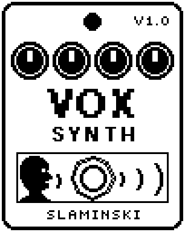

# VoxSynth 1.00

A singing voice played by your bass that says vowels and moves from one vowel to another at every note.

- **Version:** 1.00
- **Files:** `VOXSYNTH.ZD2` and `VOXSYNTH.ZIC` (install both)
- **Played by:** your bass
- **On the pedal:** PITCH SHIFT, like every effect of this collection (see [About the files](../README.md#about-the-files))
- **Id:** `07000f88`
- **DSP load:** 55, as declared to the pedal (a patch on the MS-60B+ has room for 270)
- **Delay memory:** none
- **Tested on:** one Zoom MS-60B+, firmware 1.20 only (the same effect code, installed in its own category; see [About the files](../README.md#about-the-files))

## What it does

VoxSynth turns every note you play into a voice: two short tones at the pitches a mouth would give a vowel, on the pitch of your bass. At every note the vowel moves from From to To at the speed of Speed, so a note can say "wow" or "yoi". Size and Reso shape the mouth, and Body adds a pure tone under the vowel, like a chest. It plays one note at a time, not chords.

## Playing it

- Start with the defaults: every note opens from near O to just past A, beside your clean bass.
- Set To above From for a mouth that opens ("wow"), below From for one that closes ("yoi"). Set them equal for one steady vowel.
- Speed sets how long the vowel takes to move: 4 s at 0 for a slow change, 15 ms at 100 for a quick one at the start of each note.
- For the voice alone, turn Dry to 0. Oct +1 puts the voice an octave above your bass.
- Dyn 0 makes every note as loud as the next, held until the bass stops. At 100 the voice follows your playing.

## Knobs

| Knob | Range | Default | What it does |
|---|---|---|---|
| `From` | 0 to 100 | 20 | The vowel a note starts on: 0 = U, 25 = O, 50 = A, 75 = E, 100 = I, and everything between. |
| `To` | 0 to 100 | 60 | The vowel the note moves to. Above From the mouth opens ("wow"), below it closes ("yoi"). |
| `Speed` | 0 to 100 | 55 | How fast the vowel moves from From to To: 4 s at 0, 15 ms at 100. |
| `Size` | 0 to 100 | 50 | Size of the mouth: below 50 a bigger, darker voice, above 50 a smaller, brighter one. |
| `Reso` | 0 to 100 | 50 | How long each of the two tones rings: low = soft and breathy, high = sharp and nasal. |
| `Oct` | -1, 0, +1 | 0 | The voice an octave below, on, or an octave above the note of the bass. |
| `Vowel` | 0 to 100 | 80 | Level of the vowel. Together with Body it sets the level of the voice. |
| `Body` | 0 to 100 | 30 | Level of a pure tone at the pitch of the voice, under the vowel. With Vowel at 0 it is all there is. |
| `Dyn` | 0 to 100 | 70 | How much of your playing comes through: 0 = every note as loud as the next, 100 = the level follows the bass. |
| `Dry` | 0 to 100 | 80 | Level of your bass. 80 = unchanged, as loud as bypassed; 0 = only the voice. |
| `Sens` | 0 to 100 | 50 | Input sensitivity. Raise it for a quiet bass, lower it if noise sets the voice off. |

## Good to know

- A plucked note sounds two to three cycles after the pluck.
- There is no Level knob: Vowel and Body set the level of the voice. With the defaults it is about as loud as your bass.

## Installing

Read the safety notes in the [collection's README](../README.md#read-this-first) and stomphacks' [SAFETY.md](https://github.com/thammer/stomphacks/blob/main/SAFETY.md) first. Install with [stomphacks](https://github.com/thammer/stomphacks), from its folder, one command at a time, checking each result:

1. `.venv/bin/python3 tools-pedal/safe_connect.py session/` connects and confirms that AUTO SAVE is off.
2. `.venv/bin/python3 tools-pedal/backup_pedal.py backup/` backs up the pedal (once per pedal).
3. `.venv/bin/python3 tools-pedal/pedal_diy.py install <this folder>/VOXSYNTH.ZD2 --dry-run`, then the same without `--dry-run`. It uploads `VOXSYNTH.ZIC` alongside: keep it next to the `.ZD2`, without it pedal_diy.py refuses.
4. `.venv/bin/python3 tools-pedal/readback.py VOXSYNTH.ZD2 session/VOXSYNTH-back.ZD2` and `cmp <this folder>/VOXSYNTH.ZD2 session/VOXSYNTH-back.ZD2`: they must be identical.
5. Try it in an unsaved patch, with the amp or headphones turned down.

To update to a newer version: take the effect out of every patch, `pedal_diy.py uninstall <this folder>/VOXSYNTH.ZD2` (the new file has the old one's name and id), then install the new one as in step 3 and read it back to a new path (for example `session/VOXSYNTH-back2.ZD2`; readback.py does not overwrite a file). The effect appears under PITCH SHIFT on the pedal (see the collection's README).
