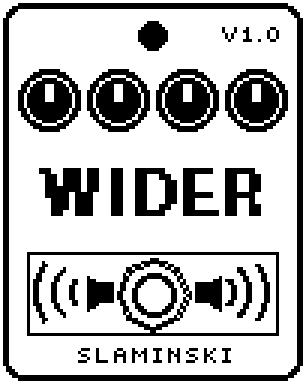

# Wider 1.00

A stereo chorus and vibrato for bass that leaves everything below a split frequency dry, so the low end stays solid even at full vibrato.

- **Version:** 1.00
- **Files:** `WIDER.ZD2` and `WIDER.ZIC` (install both)
- **Played by:** your bass
- **On the pedal:** PITCH SHIFT, like every effect of this collection (see [About the files](../README.md#about-the-files))
- **Id:** `07000f75`
- **DSP load:** 25, as declared to the pedal (a patch on the MS-60B+ has room for 270)
- **Delay memory:** 4 KB
- **Tested on:** one Zoom MS-60B+, firmware 1.20 only (the same effect code, installed in its own category; see [About the files](../README.md#about-the-files))

## What it does

Wider sends your bass through a short delay line, one per side, moved by an LFO. Mixed with the dry bass it is a chorus; alone it is a vibrato. The two sides move together or against each other (Width). Below LoCut the bass always passes dry, at every Mix setting, so even the vibrato keeps a solid low end.

## Playing it

- Start with the defaults: a slow, wide chorus above 163 Hz, with the low end dry.
- For vibrato set Mix to 100. Depth sets how far the pitch bends, Rate how fast.
- Lower LoCut to let more of the bass into the effect (at 20.0 Hz nearly all of it); raise it to keep more of it dry.
- Width 100 gives the widest stereo; at 0 both sides move the same way.

## Knobs

| Knob | Range | Default | What it does |
|---|---|---|---|
| `Depth` | 0 to 100 | 45 | How far the LFO moves the delay, up to 5 ms either way. Above 1.9 Hz the swing shrinks with Rate, so 100 bends the pitch by a semitone at most. |
| `Rate` | 0.050 Hz to 10.0 Hz | 0.71 Hz | Speed of the LFO. |
| `Mix` | 0 to 100 | 50 | For the bass above LoCut: 0 = dry only, 50 = dry and delayed alike (chorus), 100 = delayed only (vibrato). |
| `LoCut` | 20.0 Hz to 400 Hz | 163 Hz | Where the bass is split, 24 dB per octave. Below it the bass passes dry at every Mix, above it goes through the effect. |
| `Delay` | 0 to 100 | 40 | Where the delay sits, 3 ms to 18 ms. |
| `Width` | 0 to 100 | 100 | 0 = both sides move together, 100 = they move against each other. |
| `Level` | 0 to 100 | 80 | Output level. 80 = as loud as it comes in. |

## Good to know

- At Mix 100 a note right at LoCut beats rather than bends and is about 3 dB quieter on average; an octave away it is about 0.5 dB.
- Turning Rate up quickly at high Depth can bend the pitch by up to 1.3 semitones for a moment.
- Wider uses 4 KB of the pedal's delay memory. Without it, the effect stays silent.
- Right after a patch loads, the delayed copy comes in with a small step and Depth and Width fade in over about 80 ms. You may hear it if a note is ringing.

## Installing

Read the safety notes in the [collection's README](../README.md#read-this-first) and stomphacks' [SAFETY.md](https://github.com/thammer/stomphacks/blob/main/SAFETY.md) first. Install with [stomphacks](https://github.com/thammer/stomphacks), from its folder, one command at a time, checking each result:

1. `.venv/bin/python3 tools-pedal/safe_connect.py session/` connects and confirms that AUTO SAVE is off.
2. `.venv/bin/python3 tools-pedal/backup_pedal.py backup/` backs up the pedal (once per pedal).
3. `.venv/bin/python3 tools-pedal/pedal_diy.py install <this folder>/WIDER.ZD2 --dry-run`, then the same without `--dry-run`. It uploads `WIDER.ZIC` alongside: keep it next to the `.ZD2`, without it pedal_diy.py refuses.
4. `.venv/bin/python3 tools-pedal/readback.py WIDER.ZD2 session/WIDER-back.ZD2` and `cmp <this folder>/WIDER.ZD2 session/WIDER-back.ZD2`: they must be identical.
5. Try it in an unsaved patch, with the amp or headphones turned down.

To update to a newer version: take the effect out of every patch, `pedal_diy.py uninstall <this folder>/WIDER.ZD2` (the new file has the old one's name and id), then install the new one as in step 3 and read it back to a new path (for example `session/WIDER-back2.ZD2`; readback.py does not overwrite a file). The effect appears under PITCH SHIFT on the pedal (see the collection's README).
